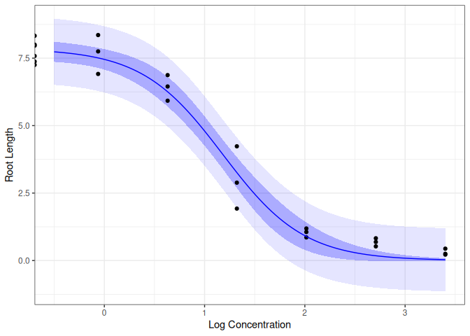

drcTMB
================

The package drcTMB provides functions to fit dose-response curves using
the Template Model Builder (TMB) framework.

## Installation

``` r
# You can install drcTMB from GitHub by
pak::pak("daniel-gerhard/drcTMB")
```

## The drmTMB function

The main function in the drcTMB package is `drmTMB()`. There is some
similarity to the `drm()` function from the drc package, with a
simplified input of response and dose variables through a formula
interface, and specifying a nonlinear model through the `model`
argument. Available models include “logistic”, “loglogistic”,
“weibull1”, “weibull2”, and “lognormal”.

Each of these models has the same parameter names, b1 for the lower and
b2 for the upper asymptote, b3 for the steepness, b4 for the location of
the inflection point on the dose scale, and b5 for an optional asymmetry
parameter. The steepness b3 is positive for an increasing and negative
for a decreasing curve. The asymmetry parameter b5 is estimated on a
logarithmic scale. The models michaelismenten, asymptoticregression, and
exponentialdecay have no steepness parameter; here b1 is the response at
dose zero and b2 the asymptote at high doses. Starting values are found
automatically from the data. The `start` argument can provide starting
values for some or all of the parameters, and the `fix` argument
(TRUE/FALSE) allows to fix parameters at these starting values.
Parameters that a model does not use, such as b5 for the Weibull models,
are fixed automatically.

``` r
library(drcTMB)
library(drcData)
data(ryegrass)
# Fitting a 3-parameter log-logistic model, with the lower asymptote b1 fixed at 0
# and without asymmetry (b5 fixed at 0)
mod <- drmTMB(rootl ~ conc, data = ryegrass, model = "loglogistic",
              start = c(b1 = 0, b5 = 0), fix = c(b1 = TRUE, b5 = TRUE))
print(mod)
#> Call:
#> drmTMB(form = rootl ~ conc, data = ryegrass, start = c(b1 = 0, 
#>     b5 = 0), fix = c(b1 = TRUE, b5 = TRUE), model = "loglogistic")
#> 
#> Model:  loglogistic
#> Family: gaussian, identity link for the asymptotes
#> 
#> Coefficients:
#> b2:(Intercept)  b3:(Intercept)  b4:(Intercept)  
#>          7.855          -2.470           3.263  
#> Fixed: b1:(Intercept) = 0, b5:(Intercept) = 0
#> 
#> Residual standard deviation: 0.5616
```

With the `predict()` method, we can visualize the fitted curve, together
with 95% confidence intervals for the mean response
(`interval = "confidence"`) and prediction intervals for a new
observation (`interval = "prediction"`).

``` r
newdata <- data.frame(conc = exp(seq(-0.5, log(30), length.out = 100)))
ci <- predict(mod, newdata = newdata, interval = "confidence")
pi <- predict(mod, newdata = newdata, interval = "prediction")
head(cbind(newdata, ci))
#>        conc      fit    se.fit      lwr      upr
#> 1 0.6065307 7.734345 0.1791433 7.361796 8.106894
#> 2 0.6309088 7.722175 0.1781019 7.351792 8.092558
#> 3 0.6562668 7.708806 0.1771504 7.340401 8.077210
#> 4 0.6826439 7.694123 0.1763198 7.327446 8.060800
#> 5 0.7100813 7.678003 0.1756451 7.312729 8.043277
#> 6 0.7386214 7.660314 0.1751653 7.296038 8.024590
newdata[c("pred", "clwr", "cupr")] <- ci[c("fit", "lwr", "upr")]
newdata[c("plwr", "pupr")] <- pi[c("lwr", "upr")]
library(ggplot2)
ggplot(ryegrass, aes(x = log(conc), y = rootl)) +
  geom_ribbon(data = newdata, aes(x = log(conc), y = pred, ymin = plwr, ymax = pupr), fill = "blue", alpha = 0.1) +
  geom_ribbon(data = newdata, aes(x = log(conc), y = pred, ymin = clwr, ymax = cupr), fill = "blue", alpha = 0.25) +
  geom_point() +
  geom_line(data = newdata, aes(x = log(conc), y = pred), color = "blue") +
  labs(x = "Log Concentration", y = "Root Length") +
  theme_bw()
```

<!-- -->

Bootstrap intervals are available by passing a parametric bootstrap
sample of the model from `bootstrap()` through the `boot` argument of
`predict()`.

## Effective dose estimation

The `ed()` function can be used to estimate effective doses (e.g., ED50,
ED90) from the fitted model, given a specified response level
(`respLev`). The effective dose ED p is the dose at which the response
has changed by p% of the difference between the asymptote at low doses
(the control) and the asymptote at high doses.

``` r
(effdose <- ed(mod, respLev = c(25, 50, 75)))
#> Effective dose estimates:
#> 
#>        Estimate Std.Error
#> 25:lf1     2.09     0.187
#> 50:lf2     3.26     0.196
#> 75:lf3     5.09     0.421
```

Profile likelihood confidence intervals of the effective doses are
computed by `confint()`; `method = "wald"` gives Wald intervals and
`method = "boot"` parametric bootstrap intervals.

``` r
confint(effdose)
#>           2.5 %   97.5 %
#> 25:lf1 1.719261 2.496939
#> 50:lf2 2.879163 3.703885
#> 75:lf3 4.332774 6.110914
```

Simultaneous confidence intervals can be constructed through the package
multcomp. For gaussian models without random effects, the residual
degrees of freedom of the model give multivariate t quantiles
(`df.residual()` is `NULL` otherwise, and multcomp then uses the normal
distribution).

``` r
library(multcomp)
linfct <- diag(3)
rownames(linfct) <- c("ED25", "ED50", "ED75")
effdose_glht <- glht(effdose, linfct = linfct, df = df.residual(mod))
confint(effdose_glht)
#> 
#>   Simultaneous Confidence Intervals
#> 
#> Fit: NULL
#> 
#> Quantile = 2.4899
#> 95% family-wise confidence level
#>  
#> 
#> Linear Hypotheses:
#>           Estimate lwr    upr   
#> ED25 == 0 2.0918   1.6270 2.5567
#> ED50 == 0 3.2634   2.7743 3.7524
#> ED75 == 0 5.0910   4.0422 6.1399
```
