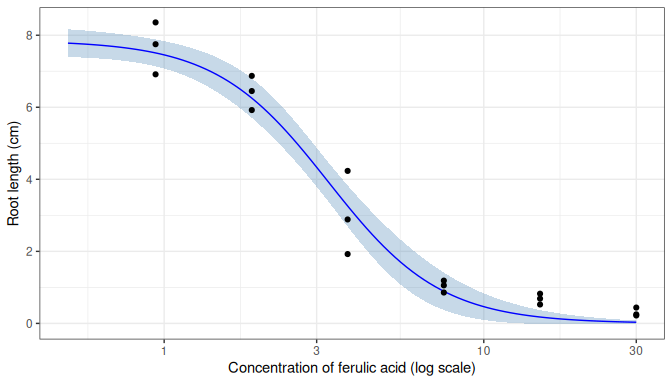
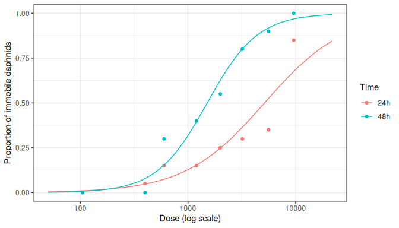
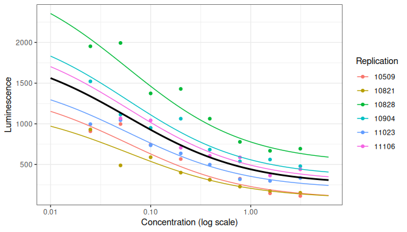

drcTMB
================

drcTMB fits nonlinear dose-response models by maximum likelihood with
the [Template Model Builder (TMB)](https://github.com/kaskr/adcomp). The
interface resembles `drm()` of the drc package, but TMB’s automatic
differentiation and Laplace approximation extend the models well beyond
nonlinear regression: random effects, non-normal responses, covariates
on every parameter, correlated residuals and priors, together with
effective doses and benchmark doses for all of them.

## Main features

- **Dose-response models**: log-logistic, logistic, Weibull (two types),
  log-normal, Gompertz, gamma, multistage, Michaelis-Menten, asymptotic
  regression, the hormesis models of Brain-Cousens and Cedergreen, the
  threshold model NEC, the substrate inhibition model of Haldane, and
  the exponential and power models of PROAST and BMDS. All share the
  parameter names b1 to b5 (lower and upper asymptote, steepness,
  location, asymmetry or shape).
- **Response distributions** (`family`): gaussian, lognormal, binomial,
  beta-binomial, poisson, negative binomial, beta, and time-to-event
  data (germination counts in time intervals).
- **Covariates** on any of the parameters (`fform`), e.g. one ED50 for
  each treatment, and links of single parameters (`parlink`) or of the
  whole curve (`curvelink`).
- **Random effects** on any of the parameters (`rform`), with correlated
  random intercepts and slopes and nested grouping factors, as in lme4.
- **Correlated residuals and variance functions** (`correlation`,
  `variance`): AR(1), continuous-time AR(1), compound symmetry and
  spatial structures; power, exponential and stratified variances, as in
  nlme.
- **Inference**: Wald, profile likelihood and parametric bootstrap
  intervals; likelihood ratio, F and bootstrap tests with `anova()`;
  robust (sandwich) standard errors, also for clustered data; confidence
  and prediction intervals with `predict()`; residual diagnostics with
  `plot()`.
- **Effective doses** (`ed()`) and the **peak** of hormesis curves
  (`peak()`), for every curve of a model, with simultaneous intervals
  and ratios of effective doses through multcomp and mratios.
- **Benchmark doses** (`bmd()`): excess and additional risk, relative
  deviation and standard deviation definitions, also with random
  effects; model averaging with AIC or BIC weights and bootstrap BMDLs
  (`bmdma()`).
- **Bayesian benchmark doses**: priors on all parameters and on the BMD
  itself, marginal likelihoods and Bayesian model averaging
  (`bmdbayes()`), and the default approach of EFSA (2022) in a single
  call (`bmdefsa()`).

## Installation

``` r
# install.packages("pak")
pak::pak("daniel-gerhard/drcTMB")
```

The examples below use data sets of the package
[drcData](https://github.com/DoseResponse/drcData).

## A first model

The root length of ryegrass decreases with the concentration of ferulic
acid. A log-logistic model with the lower asymptote b1 fixed at 0 and
without the asymmetry parameter b5 is the three-parameter model `LL.3()`
of drc.

``` r
library(drcTMB)
library(drcData)
library(ggplot2)
data(ryegrass)

mod <- drmTMB(rootl ~ conc, data = ryegrass, model = "loglogistic",
              start = c(b1 = 0, b5 = 0), fix = c(b1 = TRUE, b5 = TRUE))
mod
#> Call:
#> drmTMB(form = rootl ~ conc, data = ryegrass, start = c(b1 = 0, 
#>     b5 = 0), fix = c(b1 = TRUE, b5 = TRUE), model = "loglogistic")
#> 
#> Model:  loglogistic
#> Family: gaussian, identity link for the asymptotes
#> 
#> Coefficients:
#> b2:(Intercept)  b3:(Intercept)  b4:(Intercept)  
#>          7.855          -2.470           3.263  
#> Fixed: b1:(Intercept) = 0, b5:(Intercept) = 0
#> 
#> Residual standard deviation: 0.5616
```

`predict()` gives confidence intervals for the mean response, and with
`interval = "prediction"` prediction intervals for new observations.

``` r
nd <- data.frame(conc = exp(seq(log(0.5), log(30), length.out = 100)))
nd <- cbind(nd, predict(mod, newdata = nd, interval = "confidence"))
ggplot(nd, aes(x = conc)) +
  geom_ribbon(aes(ymin = lwr, ymax = upr), fill = "steelblue", alpha = 0.3) +
  geom_line(aes(y = fit), colour = "blue") +
  geom_point(data = subset(ryegrass, conc > 0), aes(y = rootl)) +
  scale_x_log10() +
  labs(x = "Concentration of ferulic acid (log scale)", y = "Root length (cm)") +
  theme_bw()
```

<!-- -->

Effective doses, here the concentrations that reduce the root length by
10%, 50% and 90% of the range of the curve, come with profile likelihood
intervals by default.

``` r
(eds <- ed(mod, respLev = c(10, 50, 90)))
#> Effective dose estimates:
#> 
#>        Estimate Std.Error
#> 10:lf1     1.34     0.189
#> 50:lf2     3.26     0.196
#> 90:lf3     7.94     1.055
confint(eds)
#>            2.5 %    97.5 %
#> 10:lf1 0.9813186  1.774243
#> 50:lf2 2.8791625  3.703885
#> 90:lf3 6.1400175 10.652850
```

## Several curves and a binomial response

The immobility of daphnids was recorded after 24 and 48 hours. A
binomial model with a separate steepness b3 and location b4 for each
time compares the two curves; the asymptotes are fixed at 0 and 1, and
the ED50s start at a dose of 1000.

``` r
data(daphnids)
dmod <- drmTMB(cbind(no, total - no) ~ dose, data = daphnids,
               model = "loglogistic", family = "binomial",
               fform = b3 + b4 ~ 0 + time,
               start = c(b1 = 0, b2 = 1, b4 = 1000, b5 = 0), fix = c(b1 = TRUE, b2 = TRUE, b5 = TRUE))

nd <- expand.grid(dose = exp(seq(log(50), log(22000), length.out = 100)), time = c("24h", "48h"))
nd$fit <- predict(dmod, newdata = nd)
ggplot(daphnids, aes(x = dose, y = no/total, colour = time)) +
  geom_point() +
  geom_line(data = nd, aes(y = fit)) +
  scale_x_log10() +
  labs(x = "Dose (log scale)", y = "Proportion of immobile daphnids", colour = "Time") +
  theme_bw()
```

<!-- -->

`ed()` estimates the effective doses of each curve given in `newdata`,
with their covariance matrix, so that simultaneous intervals for
differences (`multcomp::glht()`) or ratios (`mratios::gsci.ratio()`)
follow, here the relative potency of the ED50 after 24 hours to the one
after 48 hours.

``` r
(ed50 <- ed(dmod, respLev = 50, newdata = data.frame(time = c("24h", "48h"))))
#> Effective dose estimates:
#> 
#>             Estimate Std.Error
#> 50:time=24h     5134      1057
#> 50:time=48h     1509       188
mratios::gsci.ratio(coef(ed50), vcov(ed50), rbind("24h/48h" = c(1, 0)), rbind(c(0, 1)))
#> Unadjusted 95% confidence intervals 
#> Normal approximation, quantile:1.96
#>         estimate lower upper
#> 24h/48h    3.402  1.95 5.285
```

## Random effects

In the vinclozolin experiment, the luminescence was measured in six
replications. Correlated random effects of the replications on both
asymptotes capture the variation between them, and a standard deviation
proportional to a power of the mean the larger variation at high
responses.

``` r
data(vinclozolin)
vmod <- drmTMB(effect ~ conc, data = vinclozolin, model = "loglogistic",
               rform = b1 + b2 ~ 1 | exper, variance = var_power(),
               start = c(b5 = 0), fix = c(b5 = TRUE), lower = c(0, 0, -Inf, 0, -Inf))
summary(vmod)
#> Call:
#> drmTMB(form = effect ~ conc, rform = b1 + b2 ~ 1 | exper, data = vinclozolin, 
#>     start = c(b5 = 0), fix = c(b5 = TRUE), lower = c(0, 0, -Inf, 
#>         0, -Inf), model = "loglogistic", variance = var_power())
#> 
#> Model:  loglogistic, decreasing curve
#> Family: gaussian, identity link for the asymptotes
#> 
#> Number of observations: 53, groups: exper 6
#> Log-likelihood: -335.9 (df = 9), AIC: 689.9, BIC: 707.6
#> 
#> Coefficients:
#>                  Estimate Std. Error
#> b1:(Intercept)  252.72312     78.637
#> b2:(Intercept) 1924.39964    258.759
#> b3:(Intercept)   -0.72717      0.103
#> b4:(Intercept)    0.05837      0.013
#> Fixed: b5:(Intercept) = 0
#> 
#> Random effects:
#>  Groups Name Std.Dev. Corr
#>  exper  b1   156.8        
#>         b2   566.6    0.96
#> 
#> Residual standard deviation: 0.2197
#> 
#> Variance function: power, ~fitted: delta = 0.9453
#> 
#> Optimiser: nlminb: relative convergence (4), maximum absolute gradient 0.00017
```

`predict()` gives the curves of the replications and, with
`random = FALSE`, the population curve.

``` r
nd <- expand.grid(conc = exp(seq(log(0.01), log(6), length.out = 100)),
                  exper = levels(vinclozolin$exper))
nd$fit <- predict(vmod, newdata = nd)
nd$pop <- predict(vmod, newdata = nd, random = FALSE)
ggplot(subset(vinclozolin, conc > 0), aes(x = conc, y = effect, colour = exper)) +
  geom_point() +
  geom_line(data = nd, aes(y = fit)) +
  geom_line(data = nd, aes(y = pop), colour = "black", linewidth = 1) +
  scale_x_log10() +
  labs(x = "Concentration (log scale)", y = "Luminescence", colour = "Replication") +
  theme_bw()
```

<!-- -->

The standard errors of effective doses and benchmark doses include the
variation between the replications.

``` r
ed(vmod, respLev = 50)
#> Effective dose estimates:
#> 
#>        Estimate Std.Error
#> 50:lf1   0.0584    0.0131
```

## Benchmark doses

The benchmark dose (BMD) is the dose at which the response has changed
from the response at dose zero by the benchmark response; the BMDL, the
lower limit of a 90% interval, is the reference point of a risk
assessment. For a 5% decrease of the root length of ryegrass:

``` r
confint(bmd(mod, bmr = 0.05, def = "relative"), level = 0.9)
#>                5 %     95 %
#> 0.05:lf1 0.7153985 1.333767
```

As the BMD depends on the model, `bmdma()` averages it over several
models, here log-logistic and Weibull models with a normal or lognormal
response, with a bootstrap BMDL.

``` r
fitm <- function(model, family = "gaussian")
  drmTMB(rootl ~ conc, data = ryegrass, model = model, family = family,
         start = c(b1 = 0, b5 = 0), fix = c(b1 = TRUE, b5 = TRUE))
bmdma(LL = mod, W1 = fitm("weibull1"), W2 = fitm("weibull2"),
      LLlognormal = fitm("loglogistic", "lognormal"),
      bmr = 0.05, def = "relative", nsim = 200, seed = 1, progress = FALSE)
#> Model-averaged benchmark doses, relative deviation, averaged curves:
#> 
#>                   model    family logLik df   AIC   weight    BMD
#> LL          loglogistic  gaussian -18.60  4 45.21 0.138088 0.9909
#> W1             weibull1  gaussian -22.22  4 52.44 0.003712 0.7538
#> W2             weibull2  gaussian -16.78  4 41.56 0.856966 1.3520
#> LLlognormal loglogistic lognormal -23.32  4 54.64 0.001235 0.2744
#> 
#>            BMD   BMDL BMDU
#> 0.05:lf1 1.308 0.8068 1.49
#> 
#> Bootstrap percentile intervals (200 samples), level 90%
```

`bmdefsa()` follows the Bayesian model averaging of EFSA (2022), with
its default priors, and `bmdbayes()` averages models with priors of your
own.

## Hormesis

Low concentrations of isobutyl alcohol stimulate the growth of lettuce.
The Brain-Cousens model adds a hormesis effect b5 to the log-logistic
curve, and `peak()` estimates the dose and the response at the maximum.

``` r
data(lettuce)
hmod <- drmTMB(weight ~ conc, data = lettuce, model = "braincousens")
peak(hmod)
#> Peak of the hormesis curves, dose and response:
#> 
#>              Estimate Std.Error
#> dose:lf1         0.72    0.2670
#> response:lf1     1.20    0.0694
```

## Time-to-event data

Germination experiments count the seeds that germinate in each time
interval. With `family = "event"`, each row is an interval from `start`
to `end`, and the curve is the cumulative proportion of germinated
seeds. `ed()` then gives the times by which a percentage of the
germinating seeds has germinated.

``` r
data(chickweed)
gmod <- drmTMB(count ~ start + end, data = chickweed, model = "loglogistic", family = "event",
               start = c(b5 = 0), fix = c(b5 = TRUE))
ed(gmod, respLev = c(10, 50, 90))
#> Effective dose estimates:
#> 
#>        Estimate Std.Error
#> 10:lf1      176      3.49
#> 50:lf2      196      2.51
#> 90:lf3      218      4.27
```

## Robust standard errors

If the variance is misspecified, or the observations are correlated
within clusters, sandwich standard errors are available through the
argument `vcov.` of `summary()`, `confint()`, `predict()`, `ed()` and
`bmd()`, e.g. for clusters given by a variable `plate`:
`ed(fit, 50, vcov. = function(f) vcovrobust(f, cluster = ~ plate))`.

``` r
ed(mod, respLev = 50, vcov. = vcovrobust)
#> Effective dose estimates:
#> 
#>        Estimate Std.Error
#> 50:lf1     3.26     0.266
```

## Learn more

The vignette describes all features in detail, with the definitions of
the models, the families and the benchmark doses:

``` r
vignette("drcTMB")
```

To install the package with the vignette, use
`remotes::install_github("daniel-gerhard/drcTMB", build_vignettes = TRUE)`.
