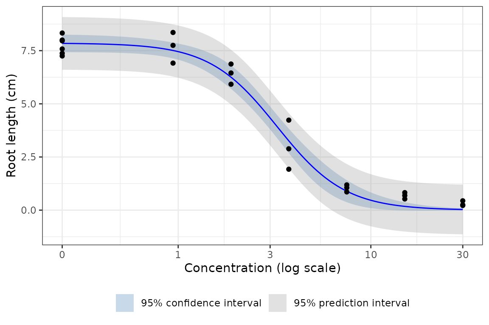
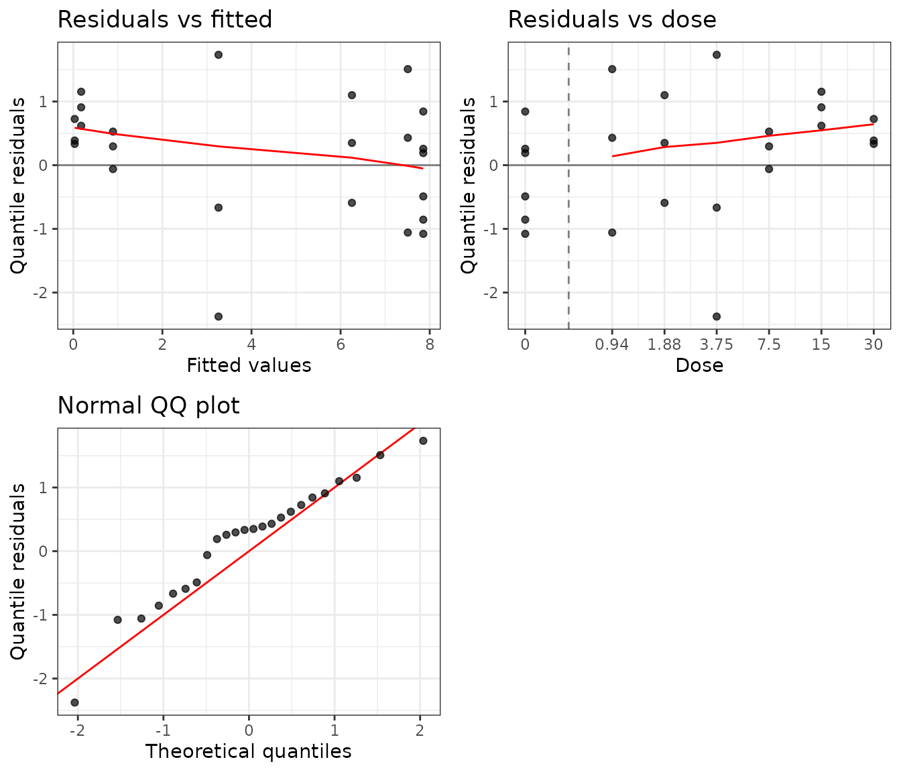
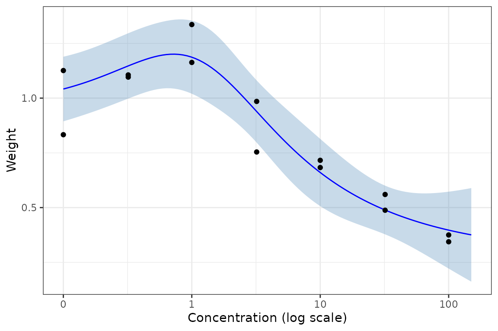
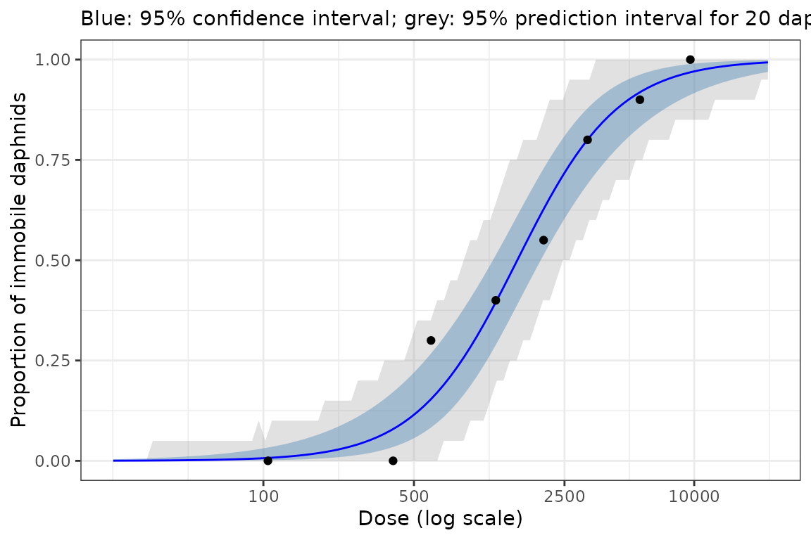
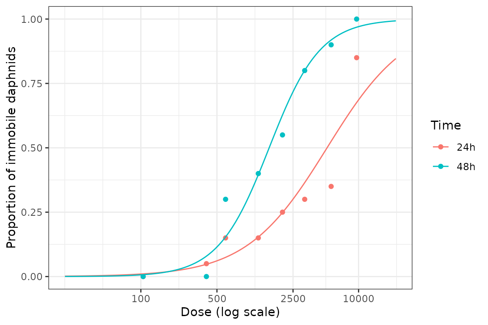
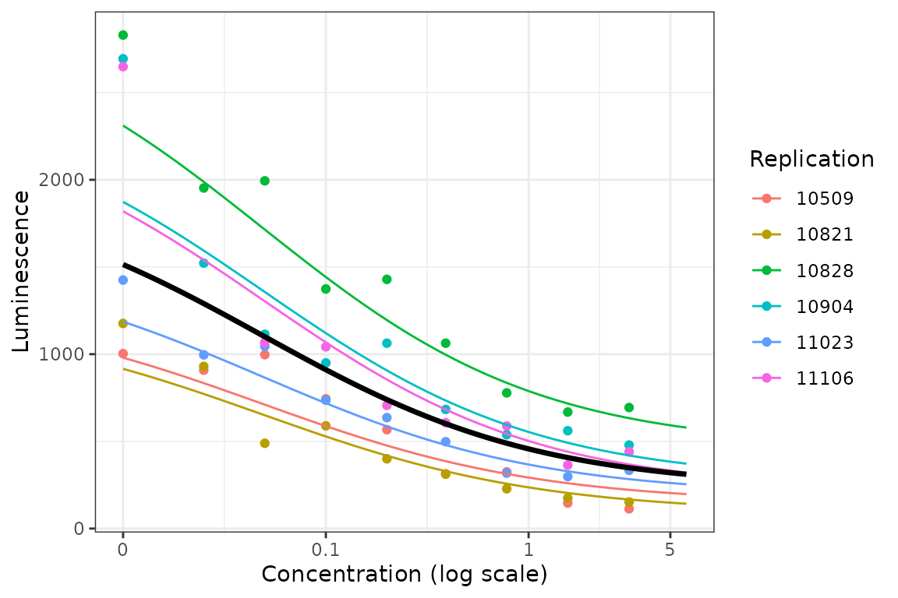
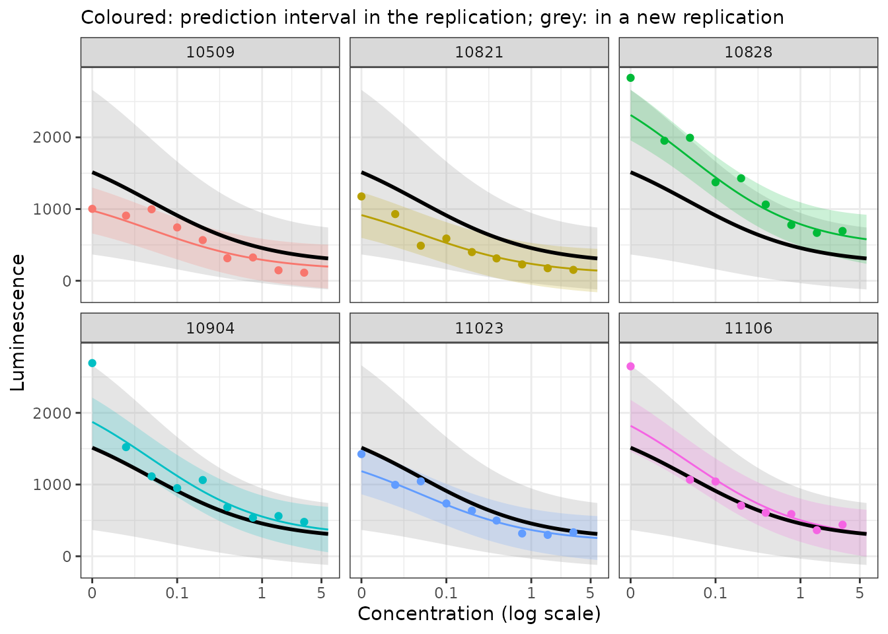
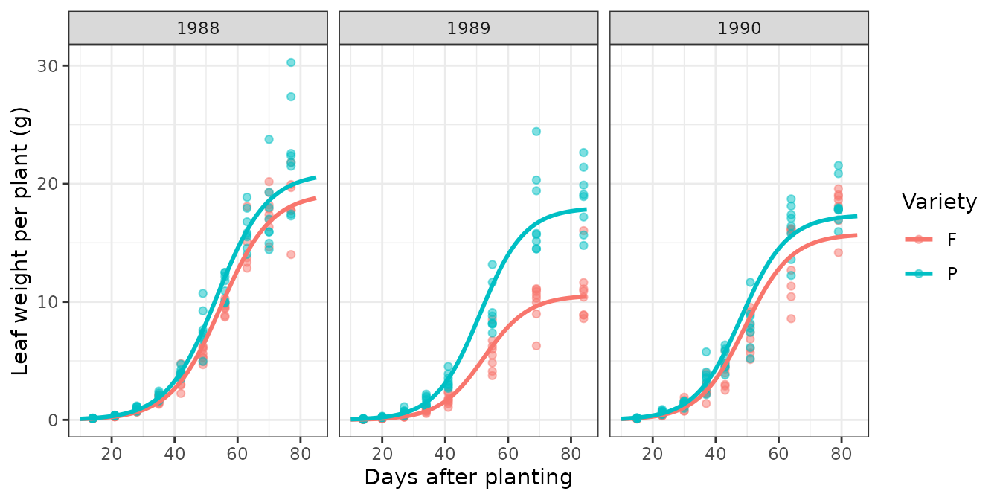

# drcTMB: dose-response models with TMB

## Introduction

drcTMB fits nonlinear dose-response models by maximum likelihood with
the Template Model Builder (TMB). The interface resembles `drm()` of the
drc package. TMB’s automatic differentiation and Laplace approximation
extend the models beyond nonlinear regression:

- non-normal responses (binomial, counts, proportions, time-to-event
  data),
- covariates and random effects on every parameter of the curve,
- correlated residuals and variance functions,
- priors, and Bayesian benchmark doses.

Effective doses and benchmark doses, with their standard errors and
confidence intervals, are available for all of these models.

The examples use data sets of drcTMB, most of them from the package
drcData, and of nlme; the plots use ggplot2.

``` r

library(drcTMB)
library(ggplot2)
```

## Fitting a dose-response model

### Models and parameters

[`drmTMB()`](https://daniel-gerhard.github.io/drcTMB/reference/drmTMB.md)
takes a formula `response ~ dose`, the data, and the name of a model
function in the argument `model`. All models share the parameter names
b1 to b5:

| Parameter | Meaning |
|:---|:---|
| b1 | lower asymptote |
| b2 | upper asymptote |
| b3 | steepness; positive for an increasing, negative for a decreasing curve |
| b4 | location of the inflection point on the dose scale (e.g. the ED50) |
| b5 | asymmetry, on the log scale (b5 = 0 is a symmetric curve) |

Some models use the parameters differently:

- **michaelismenten, asymptoticregression, exponentialdecay, gamma**: b1
  is the response at dose zero and b2 the asymptote at high doses.
- **braincousens, cedergreen** (hormesis): b5 is the size of the
  stimulation at low doses, see [Hormesis](#hormesis).
- **exponential, power**: no upper asymptote, see [Benchmark
  doses](#benchmark-doses).

The available models are:

| `model` | Curve | Similar in drc |
|:---|:---|:---|
| `"loglogistic"`, `"logistic"` | sigmoid in log(dose) or dose | `LL.5()`, `L.5()` |
| `"weibull1"`, `"weibull2"` | asymmetric sigmoid | `W1.4()`, `W2.4()` |
| `"lognormal"`, `"gompertz"` | sigmoid | `LN.4()`, `G.4()` |
| `"braincousens"`, `"cedergreen"` | hormesis | `BC.5()`, `CRS.4a()` |
| `"nec"` | threshold (no-effect concentration) | `NEC.4()` |
| `"michaelismenten"`, `"haldane"` | saturation, substrate inhibition | `MM.3()` |
| `"asymptoticregression"`, `"exponentialdecay"` | exponential approach | `AR.3()`, `EXD.3()` |
| `"gamma"`, `"multistage"` | quantal models of BMDS |  |
| `"exponential"`, `"power"` | continuous models of PROAST and BMDS |  |
| `"constant"` | no dose effect |  |

The formulas of all models are given in the
[Appendix](#appendix-model-functions).

The argument `start` gives starting values, by name, and `fix`
(TRUE/FALSE) fixes parameters at their starting values. Parameters that
a model does not use, such as b5 of the Weibull models, are fixed
automatically.

### A first model

The root length of ryegrass decreases with the concentration of ferulic
acid. A log-logistic model with the lower asymptote b1 fixed at 0 and
without asymmetry (b5 = 0) is the three-parameter model `LL.3()` of drc.

``` r

data(ryegrass)
mod <- drmTMB(rootl ~ conc, data = ryegrass, model = "loglogistic",
              start = c(b1 = 0, b5 = 0), fix = c(b1 = TRUE, b5 = TRUE))
mod
#> Call:
#> drmTMB(form = rootl ~ conc, data = ryegrass, start = c(b1 = 0, 
#>     b5 = 0), fix = c(b1 = TRUE, b5 = TRUE), model = "loglogistic")
#> 
#> Model:  loglogistic
#> Family: gaussian, identity link for the asymptotes
#> 
#> Coefficients:
#> b2:(Intercept)  b3:(Intercept)  b4:(Intercept)  
#>          7.855          -2.470           3.263  
#> Fixed: b1:(Intercept) = 0, b5:(Intercept) = 0
#> 
#> Residual standard deviation: 0.5616
```

The model is fitted by maximum likelihood. For gaussian and lognormal
models without random effects, the inference follows
[`lm()`](https://rdrr.io/r/stats/lm.html),
[`nls()`](https://rdrr.io/r/stats/nls.html) and drc by default:

- the residual standard deviation uses the unbiased residual variance
  with n - p residual degrees of freedom (`df.residual(mod)`),
- the standard errors are scaled accordingly,
- confidence and prediction intervals use t quantiles.

With `control = drmTMBcontrol(smallsample = FALSE)`, they use the
maximum likelihood estimate and normal quantiles instead. The other
families and all models with random effects use maximum likelihood and
normal quantiles.

### Confidence and prediction intervals

[`predict()`](https://rdrr.io/r/stats/predict.html) gives the fitted
curve. With `interval = "confidence"`, it adds standard errors and
confidence intervals for the mean response (delta method). With
`interval = "prediction"`, the intervals are for a new observation and
include the residual variation. The result is a data frame with the
columns `fit`, `se.fit`, `lwr` and `upr`.

``` r

# the controls (conc = 0) are drawn at a small concentration on the log axis
ryegrass$cplot <- ifelse(ryegrass$conc == 0, 0.25, ryegrass$conc)
ndata <- data.frame(conc = exp(seq(log(0.25), log(30), length.out = 100)))

ci <- predict(mod, newdata = ndata, interval = "confidence")
pri <- predict(mod, newdata = ndata, interval = "prediction")
head(ci, 3)
#>        fit    se.fit      lwr      upr
#> 1 7.841681 0.1988884 7.428069 8.255292
#> 2 7.839940 0.1983205 7.427510 8.252370
#> 3 7.837979 0.1977000 7.426839 8.249118

bands <- rbind(cbind(ndata, ci, interval = "95% confidence interval"),
               cbind(ndata, pri, interval = "95% prediction interval"))
ggplot(bands, aes(x = conc)) +
  geom_ribbon(aes(ymin = lwr, ymax = upr, fill = interval), alpha = 0.3) +
  geom_line(data = cbind(ndata, ci), aes(y = fit), colour = "blue") +
  geom_point(data = ryegrass, aes(x = cplot, y = rootl)) +
  scale_x_log10(breaks = c(0.25, 1, 3, 10, 30), labels = c("0", "1", "3", "10", "30")) +
  scale_fill_manual(values = c("steelblue", "grey60")) +
  labs(x = "Concentration (log scale)", y = "Root length (cm)", fill = NULL) +
  theme_bw() +
  theme(legend.position = "bottom")
```



Alternatively, the intervals can come from a parametric bootstrap:
[`bootstrap()`](https://daniel-gerhard.github.io/drcTMB/reference/bootstrap.md)
simulates new responses from the fitted model and fits the model again
to each of them. The same bootstrap sample can be reused for
[`predict()`](https://rdrr.io/r/stats/predict.html) and
[`confint()`](https://rdrr.io/r/stats/confint.html).

``` r

bs <- bootstrap(mod, nsim = 200, seed = 1)
head(predict(mod, newdata = ndata, interval = "confidence", boot = bs), 3)
#>        fit    se.fit      lwr      upr
#> 1 7.841681 0.1888989 7.425923 8.168309
#> 2 7.839940 0.1883664 7.425174 8.164460
#> 3 7.837979 0.1877909 7.424313 8.160199
```

### Model comparison

[`anova()`](https://rdrr.io/r/stats/anova.html) compares nested models
fitted to the same data by likelihood ratio tests, here the model with
the lower asymptote fixed at 0 against a model with an estimated lower
asymptote:

``` r

mod4 <- update(mod, start = c(b5 = 0), fix = c(b5 = TRUE))
anova(mod, mod4)
#> Likelihood ratio tests of drmTMB models
#> 
#>      npar    AIC    BIC  logLik deviance Chisq Df Pr(>Chisq)  
#> mod     4 45.208 49.920 -18.604   37.208                      
#> mod4    5 42.310 48.201 -16.155   32.310 4.898  1    0.02689 *
#> ---
#> Signif. codes:  0 '***' 0.001 '**' 0.01 '*' 0.05 '.' 0.1 ' ' 1
```

For gaussian and lognormal models without random effects, F-tests
account for the estimation of the residual variance, as in drc. They are
usually preferable for small experiments.

``` r

anova(mod, mod4, test = "F")
#> F-tests of drmTMB models
#> 
#>      npar    AIC    BIC  logLik Res.Df    RSS     F Df  Pr(>F)  
#> mod     4 45.208 49.920 -18.604     21 6.6228                   
#> mod4    5 42.310 48.201 -16.155     20 5.4002 4.528  1 0.04597 *
#> ---
#> Signif. codes:  0 '***' 0.001 '**' 0.01 '*' 0.05 '.' 0.1 ' ' 1
```

The model `"constant"`, with the same mean b1 at all doses, tests
whether the response changes with the dose at all, as `noEffect()` in
drc:

``` r

mod0 <- update(mod, model = "constant", start = NULL, fix = NULL)
anova(mod0, mod)
#> Likelihood ratio tests of drmTMB models
#> 
#>      npar     AIC    BIC  logLik deviance Chisq Df Pr(>Chisq)    
#> mod0    2 128.188 130.54 -62.094  124.188                        
#> mod     4  45.208  49.92 -18.604   37.208 86.98  2  < 2.2e-16 ***
#> ---
#> Signif. codes:  0 '***' 0.001 '**' 0.01 '*' 0.05 '.' 0.1 ' ' 1
```

The chi-square distribution of the likelihood ratio statistic is only an
approximation here: the steepness and location of the curve are not
identified under the constant model. The same applies to small
experiments and to tests of a standard deviation of random effects
against zero. A parametric bootstrap test, `test = "boot"`, simulates
responses from the smaller model and fits both models to each of them.
With 100 simulations, the smallest possible p-value is 1/101.

``` r

anova(mod0, mod, test = "boot", nsim = 100, seed = 1)
#> Parametric bootstrap likelihood ratio tests of drmTMB models
#> Simulations from the smaller model: 100
#> 
#>      npar     AIC    BIC  logLik deviance Chisq Df Pr(>Chisq) Pr(boot)   
#> mod0    2 128.188 130.54 -62.094  124.188                                
#> mod     4  45.208  49.92 -18.604   37.208 86.98  2 1.2959e-19 0.009901 **
#> ---
#> Signif. codes:  0 '***' 0.001 '**' 0.01 '*' 0.05 '.' 0.1 ' ' 1
```

### Model diagnostics

[`plot()`](https://rdrr.io/r/graphics/plot.default.html) draws the
residuals against the fitted values and against the dose, and a normal
QQ plot.

- The default randomised quantile residuals are standard normal under
  the model, for all families.
- A trend of the residuals against the dose points to a model function
  that does not fit the data.
- `which = 4` adds QQ plots of the predicted random effects for models
  with random effects.

The graphs are ggplot2 objects, returned invisibly, so a single one can
be changed and drawn again.

``` r

plot(mod)
```



## Effective doses

[`ed()`](https://daniel-gerhard.github.io/drcTMB/reference/ed.md)
estimates effective doses for the response levels `respLev`. The
effective dose ED p is the dose at which the response has changed by p%
of the difference between the asymptote at low doses (the control) and
the asymptote at high doses. Confidence intervals from
[`confint()`](https://rdrr.io/r/stats/confint.html) are profile
likelihood intervals by default.

``` r

(effdose <- ed(mod, respLev = c(25, 50, 75)))
#> Effective dose estimates:
#> 
#>        Estimate Std.Error
#> 25:lf1     2.09     0.187
#> 50:lf1     3.26     0.196
#> 75:lf1     5.09     0.421
confint(effdose)
#> Computing profile confidence intervals ...
#>           2.5 %   97.5 %
#> 25:lf1 1.719261 2.496939
#> 50:lf1 2.879163 3.703885
#> 75:lf1 4.332774 6.110914
```

Simultaneous confidence intervals follow from the package multcomp. For
gaussian models without random effects, the residual degrees of freedom
give multivariate t quantiles
([`df.residual()`](https://rdrr.io/r/stats/df.residual.html) is `NULL`
otherwise, and multcomp then uses the normal distribution).

``` r

library(multcomp)
linfct <- diag(3)
rownames(linfct) <- c("ED25", "ED50", "ED75")
confint(glht(effdose, linfct = linfct, df = df.residual(mod)))
#> 
#>   Simultaneous Confidence Intervals
#> 
#> Fit: NULL
#> 
#> Quantile = 2.4931
#> 95% family-wise confidence level
#>  
#> 
#> Linear Hypotheses:
#>           Estimate lwr    upr   
#> ED25 == 0 2.0918   1.6264 2.5573
#> ED50 == 0 3.2634   2.7737 3.7530
#> ED75 == 0 5.0910   4.0408 6.1412
```

With `type = "absolute"`, `respLev` gives values of the response
instead, and
[`ed()`](https://daniel-gerhard.github.io/drcTMB/reference/ed.md)
estimates the doses at which the curve reaches them, here a root length
of 2, 4 and 6 cm. These doses depend on the asymptotes as well, which is
included in the standard errors.

``` r

ed(mod, respLev = c(2, 4, 6), type = "absolute")
#> Effective dose estimates:
#> 
#>         Estimate Std.Error
#> y=2:lf1     5.04     0.414
#> y=4:lf1     3.22     0.173
#> y=6:lf1     2.03     0.156
```

## Hormesis

Some toxic substances stimulate growth at low doses before the response
declines. Two hormesis models add a term $`b_5\,g(x)`$ to a log-logistic
curve:

- Brain and Cousens, `model = "braincousens"`, with $`g(x) = x`$,
- Cedergreen, Ritz and Streibig, `model = "cedergreen"`, with
  $`g(x) = \exp(-1/x^\alpha)`$. The argument `alpha` sets the exponent:
  1, 0.5 and 0.25 give the models CRS.a, CRS.b and CRS.c of drc.

Here b2 is the response of the control, b1 the lower asymptote, and b3
\< 0 for the decreasing curve. The hormesis effect b5 is on the scale of
the response, and b5 = 0 is the log-logistic model, so
[`anova()`](https://rdrr.io/r/stats/anova.html) tests for hormesis. In
the lettuce data, the plant weight increases at low concentrations of
isobutyl alcohol.

``` r

data(lettuce)
hmod <- drmTMB(weight ~ conc, data = lettuce, model = "braincousens")
hmod0 <- drmTMB(weight ~ conc, data = lettuce, model = "loglogistic",
                start = c(b5 = 0), fix = c(b5 = TRUE))
anova(hmod0, hmod, test = "F")
#> F-tests of drmTMB models
#> 
#>       npar     AIC      BIC logLik Res.Df     RSS      F Df  Pr(>F)  
#> hmod0    5  -9.262  -6.0667  9.631     10 0.20708                    
#> hmod     6 -15.036 -11.2016 13.518      9 0.11884 6.6819  1 0.02946 *
#> ---
#> Signif. codes:  0 '***' 0.001 '**' 0.01 '*' 0.05 '.' 0.1 ' ' 1
```

``` r

lettuce$cplot <- ifelse(lettuce$conc == 0, 0.1, lettuce$conc)
hdata <- data.frame(conc = exp(seq(log(0.1), log(150), length.out = 100)))
hdata <- cbind(hdata, predict(hmod, newdata = hdata, interval = "confidence"))
ggplot(hdata, aes(x = conc)) +
  geom_ribbon(aes(ymin = lwr, ymax = upr), fill = "steelblue", alpha = 0.3) +
  geom_line(aes(y = fit), colour = "blue") +
  geom_point(data = lettuce, aes(x = cplot, y = weight)) +
  scale_x_log10(breaks = c(0.1, 1, 10, 100), labels = c("0", "1", "10", "100")) +
  labs(x = "Concentration (log scale)", y = "Weight") +
  theme_bw()
```



The effective dose ED p of a hormesis model is the dose above the peak
at which the response has decreased from the control by p% of the
difference to the lower asymptote, as in drc. It has no closed form and
is found numerically. Its standard errors follow from the implicit
function theorem, also with random effects, and profile and bootstrap
intervals are available as for the other models.

``` r

ed(hmod, respLev = c(10, 50))
#> Effective dose estimates:
#> 
#>        Estimate Std.Error
#> 10:lf1     3.75       1.4
#> 50:lf1    12.30      12.2
```

[`peak()`](https://daniel-gerhard.github.io/drcTMB/reference/peak.md)
estimates the dose at the peak of the stimulation and the maximal
response, as `MAX()` in drc, with their joint covariance matrix.
`respLev = 0` in
[`ed()`](https://daniel-gerhard.github.io/drcTMB/reference/ed.md) gives
the dose at which the response returns to the level of the control, the
limit of the stimulation. Profile intervals are not available for the
maximal response; Wald intervals are given for it.

``` r

(hpeak <- peak(hmod))
#> Peak of the hormesis curves, dose and response:
#> 
#>              Estimate Std.Error
#> dose:lf1         0.72    0.2670
#> response:lf1     1.20    0.0694
confint(hpeak)
#> Wald intervals for the response at the peak: profile intervals are not available.
#> Computing profile confidence intervals ...
#>                 2.5 %   97.5 %
#> dose:lf1     0.237952 1.431801
#> response:lf1 1.043817 1.357752
ed(hmod, respLev = 0)
#> Effective dose estimates:
#> 
#>       Estimate Std.Error
#> 0:lf1     2.93      1.05
```

## Response distributions

### Families

The argument `family` sets the distribution of the response, with the
same parameterisations as glmmTMB:

| `family` | Response | Dispersion |
|:---|:---|:---|
| `"gaussian"` (default) | continuous | residual standard deviation |
| `"lognormal"` | positive, constant coefficient of variation | standard deviation of log(y) |
| `"binomial"` | `cbind(successes, failures)` |  |
| `"betabinomial"` | overdispersed binomial counts | precision phi |
| `"poisson"` | counts |  |
| `"nbinom2"` | overdispersed counts | variance mu (1 + mu/theta) |
| `"nbinom1"` | overdispersed counts | variance mu (1 + phi) |
| `"beta"` | proportions in (0, 1) | precision phi |
| `"event"` | counts of events in time intervals | see [Time-to-event data](#time-to-event-data) |

For the lognormal family, log(y) is normal around the log of the curve.
The curve is then the median (geometric mean) of the response, as in
PROAST and the BMDS of the US EPA. The log-likelihood is that of y, so
AIC compares gaussian and lognormal fits.

### A binomial response

For the proportion of immobile daphnids after 48 hours, we fit a
two-parameter log-logistic model, with the asymptotes fixed at 0 and 1
and without asymmetry. With only eight doses, b5 cannot be estimated
reliably: in a model with b5, the parameters b3, b4 and b5 are almost
perfectly correlated, with very large standard errors.

``` r

data(daphnids)
d48 <- subset(daphnids, time == "48h")
dmod <- drmTMB(cbind(no, total - no) ~ dose, data = d48, model = "loglogistic", family = "binomial",
               start = c(b1 = 0, b2 = 1, b4 = 1000, b5 = 0), fix = c(b1 = TRUE, b2 = TRUE, b5 = TRUE))
dmod
#> Call:
#> drmTMB(form = cbind(no, total - no) ~ dose, data = d48, start = c(b1 = 0, 
#>     b2 = 1, b4 = 1000, b5 = 0), fix = c(b1 = TRUE, b2 = TRUE, 
#>     b5 = TRUE), family = "binomial", model = "loglogistic")
#> 
#> Model:  loglogistic
#> Family: binomial, identity link for the asymptotes
#> 
#> Coefficients:
#> b3:(Intercept)  b4:(Intercept)  
#>           1.85         1509.06  
#> Fixed: b1:(Intercept) = 0, b2:(Intercept) = 1, b5:(Intercept) = 0
```

The confidence intervals for the mean proportion are computed on the
logit scale, so that they stay between 0 and 1. For the binomial,
poisson and beta families, prediction intervals are quantiles of new
observations, simulated at `nsim` draws from the approximate normal
distribution of the estimates. The number of trials of the new
observations comes from the response variables in `newdata`, here a new
beaker with 20 daphnids at each dose (the value of `no` is not used).

``` r

ndata <- data.frame(dose = exp(seq(3, log(22000), length.out = 100)), no = 0, total = 20)
cib <- predict(dmod, newdata = ndata, interval = "confidence")
pib <- predict(dmod, newdata = ndata, interval = "prediction", nsim = 2000, seed = 1)

ggplot(cbind(ndata, pib), aes(x = dose)) +
  geom_ribbon(aes(ymin = lwr, ymax = upr), fill = "grey60", alpha = 0.3) +
  geom_ribbon(data = cbind(ndata, cib), aes(ymin = lwr, ymax = upr), fill = "steelblue", alpha = 0.4) +
  geom_line(aes(y = fit), colour = "blue") +
  geom_point(data = d48, aes(y = no/total)) +
  scale_x_log10(breaks = c(100, 500, 2500, 10000)) +
  labs(x = "Dose (log scale)", y = "Proportion of immobile daphnids",
       subtitle = "Blue: 95% confidence interval; grey: 95% prediction interval for 20 daphnids") +
  theme_bw()
```



The simulated prediction intervals rely on the normal approximation of
the estimates. For models with poorly identified parameters, a bootstrap
sample (`boot = bootstrap(dmod)`) is the safer choice.

### Parameter links and bounds

The argument `parlink` estimates parameters on a transformed scale,
which can improve the optimisation:

- a single link, e.g. `parlink = "logit"`, applies to the asymptotes b1
  and b2;
- links named by parameter,
  e.g. `parlink = c(b1 = "logit", b4 = "log")`, apply to single
  parameters, with the defaults of the model for the others.

The asymptotes have the identity (default), log or logit link. The log
link of b4 is available for the models with a positive b4; random
effects on b4 then change the ED50 by a factor between groups, as in a
logistic model of the log dose. The asymmetry b5 of the logistic and
loglogistic models and the shape b5 of nec always have the log link.

`predict(fit, newdata, type = "parameters")` gives the parameters of the
curves, e.g. b4 of each group or treatment, on their original scale or,
with `scale = "link"`, on the scale of the coefficients, with standard
errors and confidence intervals.

The arguments `lower` and `upper` set bounds for the parameters.

### Curve links

While `parlink` transforms single parameters, `curvelink` is a link of
the whole curve, as in a generalised linear model. The mean (the median
for the lognormal family, the probability for binomial responses) is the
inverse link of the curve:

- `curvelink = "log"`: `exp(f(x))`,
- `curvelink = "probit"`: `pnorm(f(x))`,
- `curvelink = "logit"`: `plogis(f(x))`.

The lognormal family with `curvelink = "log"` puts the curve on the
scale of log(y), as in the lognormal models of EFSA (2022). The power
model with a probit or logit curve link gives their quantal probit and
logistic models. Effective doses refer to the curve, while
[`predict()`](https://rdrr.io/r/stats/predict.html) and the benchmark
doses of
[`bmd()`](https://daniel-gerhard.github.io/drcTMB/reference/bmd.md) are
on the scale of the response.

``` r

clmod <- drmTMB(rootl ~ conc, data = ryegrass, model = "weibull2", family = "lognormal",
                curvelink = "log", start = c(b5 = 0), fix = c(b5 = TRUE))
clmod
#> Call:
#> drmTMB(form = rootl ~ conc, data = ryegrass, start = c(b5 = 0), 
#>     fix = c(b5 = TRUE), family = "lognormal", model = "weibull2", 
#>     curvelink = "log")
#> 
#> Model:  weibull2
#> Family: lognormal, identity link for the asymptotes; log link of the curve, the mean (median) is exp(curve)
#> 
#> Coefficients:
#> b1:(Intercept)  b2:(Intercept)  b3:(Intercept)  b4:(Intercept)  
#>        -1.8332          2.0641         -0.9358          5.2444  
#> 
#> Residual standard deviation of log(y): 0.2265
bmd(clmod, bmr = 0.05, def = "relative")
#> Benchmark doses, relative deviation:
#> 
#>          Estimate Std.Error
#> 0.05:lf1      1.1     0.294
```

## Covariates on the parameters

The argument `fform` adds covariates to the parameters, with the
parameters on the left-hand side of a formula,
e.g. `b3 + b4 ~ 0 + time`, or a list of such formulas. Parameters that
are not listed have a single intercept. For the daphnids after 24 and 48
hours, each time gets its own steepness and ED50:

``` r

dmodg <- drmTMB(cbind(no, total - no) ~ dose, data = daphnids,
                model = "loglogistic", family = "binomial",
                fform = b3 + b4 ~ 0 + time,
                start = c(b1 = 0, b2 = 1, b4 = 1000, b5 = 0), fix = c(b1 = TRUE, b2 = TRUE, b5 = TRUE))
dmodg
#> Call:
#> drmTMB(form = cbind(no, total - no) ~ dose, fform = b3 + b4 ~ 
#>     0 + time, data = daphnids, start = c(b1 = 0, b2 = 1, b4 = 1000, 
#>     b5 = 0), fix = c(b1 = TRUE, b2 = TRUE, b5 = TRUE), family = "binomial", 
#>     model = "loglogistic")
#> 
#> Model:  loglogistic
#> Family: binomial, identity link for the asymptotes
#> 
#> Coefficients:
#> b3:time24h  b3:time48h  b4:time24h  b4:time48h  
#>      1.174       1.850    5134.036    1509.065  
#> Fixed: b1:(Intercept) = 0, b2:(Intercept) = 1, b5:(Intercept) = 0
```

``` r

ndatag <- expand.grid(dose = exp(seq(3, log(22000), length.out = 100)),
                      time = c("24h", "48h"))
ndatag$pred <- predict(dmodg, newdata = ndatag)

ggplot(daphnids, aes(x = dose, y = no/total, colour = time)) +
  geom_point() +
  geom_line(data = ndatag, aes(y = pred)) +
  scale_x_log10(breaks = c(100, 500, 2500, 10000)) +
  labs(x = "Dose (log scale)", y = "Proportion of immobile daphnids", colour = "Time") +
  theme_bw()
```



### Effective doses for covariate values

The argument `newdata` of
[`ed()`](https://daniel-gerhard.github.io/drcTMB/reference/ed.md)
specifies the curves by the values of the covariates in `fform`, one
curve for each row. The effective doses are computed for each level of
`respLev` and each curve, with their joint covariance matrix, so that
multcomp gives simultaneous intervals for differences:

``` r

(ed75 <- ed(dmodg, respLev = 75, newdata = data.frame(time = c("24h", "48h"))))
#> Effective dose estimates:
#> 
#>             Estimate Std.Error
#> 75:time=24h    13089      4346
#> 75:time=48h     2733       406

lfdiff <- rbind("24h" = c(1, 0),
                "48h" = c(0, 1),
                "48h-24h" = c(-1, 1))
confint(glht(ed75, linfct = lfdiff))
#> 
#>   Simultaneous Confidence Intervals
#> 
#> Fit: NULL
#> 
#> Quantile = 2.2528
#> 95% family-wise confidence level
#>  
#> 
#> Linear Hypotheses:
#>              Estimate    lwr         upr        
#> 24h == 0      13089.4798   3297.9677  22880.9918
#> 48h == 0       2733.1072   1817.8252   3648.3892
#> 48h-24h == 0 -10356.3726 -20190.5706   -522.1746
```

Ratios of effective doses, e.g. the relative potency of two curves, are
often more natural than differences.
[`gsci.ratio()`](https://rdrr.io/pkg/mratios/man/gsci.ratio.html) of the
package mratios gives simultaneous confidence intervals for ratios, here
for the ED50 and ED75 after 24 hours relative to 48 hours:

``` r

library(mratios)
ed5075 <- ed(dmodg, respLev = c(50, 75), newdata = data.frame(time = c("24h", "48h")))
num <- rbind("ED50 24h/48h" = c(1, 0, 0, 0),
             "ED75 24h/48h" = c(0, 0, 1, 0))
den <- rbind(c(0, 1, 0, 0),
             c(0, 0, 0, 1))
gsci.ratio(coef(ed5075), vcov(ed5075), num, den)
#> Simultaneous 95% confidence intervals 
#> Normal approximation, quantile:2.128
#>              estimate lower upper
#> ED50 24h/48h    3.402 1.835 5.483
#> ED75 24h/48h    4.789 1.377 9.267
```

More generally, the argument `linfct` defines the parameters b1 to b5 of
each curve as linear functions of the model coefficients, with one
matrix for each curve. For the two curves above, with the coefficients
b1, b2, b3:time24h, b3:time48h, b4:time24h, b4:time48h and b5:

``` r

linfct <- list("24h" = rbind(c(1, 0, 0, 0, 0, 0, 0),
                             c(0, 1, 0, 0, 0, 0, 0),
                             c(0, 0, 1, 0, 0, 0, 0),
                             c(0, 0, 0, 0, 1, 0, 0),
                             c(0, 0, 0, 0, 0, 0, 1)),
               "48h" = rbind(c(1, 0, 0, 0, 0, 0, 0),
                             c(0, 1, 0, 0, 0, 0, 0),
                             c(0, 0, 0, 1, 0, 0, 0),
                             c(0, 0, 0, 0, 0, 1, 0),
                             c(0, 0, 0, 0, 0, 0, 1)))
ed(dmodg, respLev = 75, linfct = linfct)
#> Effective dose estimates:
#> 
#>        Estimate Std.Error
#> 75:24h    13089      4346
#> 75:48h     2733       406
```

## Time-to-event data

Germination and other time-to-event experiments record the number of
events in each time interval, as `type = "event"` in drc. With
`family = "event"` and the formula `count ~ start + end`:

- each row is an interval \[start, end) with its number of events,
- a row with `end = Inf` holds the units without an event by the end of
  the experiment,
- the curve is the cumulative proportion of events, b2 F(t), with b1
  fixed at 0 and the proportion b2 of units with an event on the logit
  scale.

For the germination of chickweed seeds, 20% of the seeds germinate, half
of them by 196 hours:

``` r

data(chickweed)
gmod <- drmTMB(count ~ start + end, data = chickweed, model = "loglogistic", family = "event",
               start = c(b5 = 0), fix = c(b5 = TRUE))
gmod
#> Call:
#> drmTMB(form = count ~ start + end, data = chickweed, start = c(b5 = 0), 
#>     fix = c(b5 = TRUE), family = "event", model = "loglogistic")
#> 
#> Model:  loglogistic
#> Family: event, identity link for b1, logit link for b2
#> 
#> Coefficients:
#> b2:(Intercept)  b3:(Intercept)  b4:(Intercept)  
#>         -1.386          20.767         196.053  
#> Fixed: b1:(Intercept) = 0, b5:(Intercept) = 0
plogis(coef(gmod)[1])
#> b2:(Intercept) 
#>      0.2001092
ed(gmod, c(10, 50, 90))
#> Effective dose estimates:
#> 
#>        Estimate Std.Error
#> 10:lf1      176      3.49
#> 50:lf1      196      2.51
#> 90:lf1      218      4.27
```

[`ed()`](https://daniel-gerhard.github.io/drcTMB/reference/ed.md) gives
the times at which a percentage of the germinating seeds has germinated.
With `type = "absolute"`, it gives the time at which a proportion of all
seeds has germinated, here 10%:

``` r

ed(gmod, 0.1, type = "absolute")
#> Effective dose estimates:
#> 
#>           Estimate Std.Error
#> y=0.1:lf1      196      3.66
```

Covariates (`fform`) and random effects (`rform`) work as for the other
families, e.g. `rform = b4 ~ 1 | dish` for Petri dishes that germinate
faster or slower. The argument `series` identifies the intervals of one
dish; by default, these are the rows with the same covariates and levels
of the random effects.
[`simulate()`](https://rdrr.io/r/stats/simulate.html) and
[`bootstrap()`](https://daniel-gerhard.github.io/drcTMB/reference/bootstrap.md)
then draw multinomial counts with the total of each dish, and the
residuals and the Pearson dispersion of
[`summary()`](https://rdrr.io/r/base/summary.html) compare the counts
with these totals.

## Random effects

The argument `rform` adds random effects to the parameters, with the
syntax of lme4: the parameters on the left-hand side, and random
intercepts, slopes and grouping factors on the right-hand side, e.g.

- `b2 ~ 1 | exper`: a random intercept of b2 for each experiment,
- `b1 + b2 ~ 1 | exper`: correlated random intercepts of b1 and b2,
- `b4 ~ time | exper`: random intercepts and slopes of b4 in a covariate
  `time`,
- `b2 ~ 1 | lab/plate`: nested grouping factors,
- a list of formulas for random effects with different grouping factors.

The likelihood integrates over the random effects with the Laplace
approximation.

The vinclozolin data contain luminescence measurements of a
dose-response experiment with six replications. A log-logistic model
with correlated random effects of the replications on the asymptotes b1
and b2 describes the variation between them. With only six replications,
an additional random effect on b4 cannot be estimated reliably. The
argument `lower` keeps the asymptotes and b4 positive, to help the
optimisation.

``` r

data(vinclozolin)
vmod <- drmTMB(effect ~ conc, data = vinclozolin, model = "loglogistic",
               rform = b1 + b2 ~ 1 | exper,
               start = c(b5 = 0), fix = c(b5 = TRUE),
               lower = c(0, 0, -Inf, 0, -Inf))
summary(vmod)
#> Call:
#> drmTMB(form = effect ~ conc, rform = b1 + b2 ~ 1 | exper, data = vinclozolin, 
#>     start = c(b5 = 0), fix = c(b5 = TRUE), lower = c(0, 0, -Inf, 
#>         0, -Inf), model = "loglogistic")
#> 
#> Model:  loglogistic, decreasing curve
#> Family: gaussian, identity link for the asymptotes
#> 
#> Number of observations: 53, groups: exper 6
#> Log-likelihood: -350.8 (df = 8), AIC: 717.6, BIC: 733.4
#> 
#> Coefficients:
#>                  Estimate Std. Error
#> b1:(Intercept)  231.76111    114.663
#> b2:(Intercept) 1987.00272    281.547
#> b3:(Intercept)   -0.63299      0.115
#> b4:(Intercept)    0.04835      0.011
#> Fixed: b5:(Intercept) = 0
#> 
#> Random effects:
#>  Groups Name Std.Dev. Corr
#>  exper  b1   129.3        
#>         b2   676.0    0.82
#> 
#> Residual standard deviation: 139.7
#> 
#> Optimiser: nlminb: relative convergence (4), maximum absolute gradient 0.00049
```

[`predict()`](https://rdrr.io/r/stats/predict.html) gives the curves of
the replications, conditional on their predicted random effects, and
with `random = FALSE` the population curve, with the random effects at
zero.

``` r

vinclozolin$cplot <- ifelse(vinclozolin$conc == 0, 0.01, vinclozolin$conc)
ndatav <- expand.grid(conc = exp(seq(log(0.01), log(6), length.out = 200)),
                      exper = levels(vinclozolin$exper))
ndatav$pred <- predict(vmod, newdata = ndatav)
ndatav$predpop <- predict(vmod, newdata = ndatav, random = FALSE)

ggplot(vinclozolin, aes(x = cplot, y = effect, colour = exper)) +
  geom_point() +
  geom_line(data = ndatav, aes(x = conc, y = pred)) +
  geom_line(data = ndatav, aes(x = conc, y = predpop), colour = "black", linewidth = 1.2) +
  scale_x_log10(breaks = c(0.01, 0.1, 1, 5), labels = c("0", "0.1", "1", "5")) +
  labs(x = "Concentration (log scale)", y = "Luminescence", colour = "Replication") +
  theme_bw()
```



### Prediction intervals

With random effects, the argument `random` decides which new observation
a prediction interval is for:

- `random = TRUE` (default): a new observation in the replication of
  each row of `newdata`, using its predicted random effects; the
  standard errors include the uncertainty of the predicted random
  effects.
- `random = FALSE`: a new observation in a new replication; the variance
  of the random effects is added.

Rows of `newdata` with a replication that is not in the data are treated
as new replications.

``` r

# a new observation in each of the six replications
pic <- cbind(ndatav, predict(vmod, newdata = ndatav, interval = "prediction"))
# a new observation in a new replication
ndatap <- data.frame(conc = unique(ndatav$conc))
pin <- cbind(ndatap, predict(vmod, newdata = ndatap, random = FALSE, interval = "prediction"))

ggplot(pic, aes(x = conc)) +
  geom_ribbon(data = pin, aes(ymin = lwr, ymax = upr), fill = "grey60", alpha = 0.25) +
  geom_ribbon(aes(ymin = lwr, ymax = upr, fill = exper), alpha = 0.2) +
  geom_line(aes(y = fit, colour = exper)) +
  geom_line(data = pin, aes(y = fit), linewidth = 1) +
  geom_point(data = vinclozolin, aes(x = cplot, y = effect, colour = exper)) +
  facet_wrap(~ exper) +
  scale_x_log10(breaks = c(0.01, 0.1, 1, 5), labels = c("0", "0.1", "1", "5")) +
  labs(x = "Concentration (log scale)", y = "Luminescence",
       subtitle = "Coloured: prediction interval in the replication; grey: in a new replication") +
  theme_bw() +
  theme(legend.position = "none")
```



### Effective doses

[`ed()`](https://daniel-gerhard.github.io/drcTMB/reference/ed.md)
estimates effective doses and their standard errors by the delta method.
By default, the standard errors include the variance components of the
random effects. Here, the random effects are on the asymptotes only. As
the effective doses are defined relative to the asymptotes, they do not
depend on these random effects, and the standard error is the same as
for the population curve.

``` r

ed(vmod, respLev = 50, random = TRUE)
#> Effective dose estimates:
#> 
#>        Estimate Std.Error
#> 50:lf1   0.0483    0.0109
```

With `residual = TRUE`, the standard error also includes the residual
variance:

``` r

ed(vmod, respLev = 50, random = TRUE, residual = TRUE)
#> Effective dose estimates:
#> 
#>        Estimate Std.Error
#> 50:lf1   0.0483    0.0267
```

With a grouping variable in `newdata`,
[`ed()`](https://daniel-gerhard.github.io/drcTMB/reference/ed.md) gives
the effective doses of the curves of fitted groups, conditional on their
predicted random effects,
e.g. `ed(vmod, 50, newdata = data.frame(exper = "10509"))`. With random
slopes, `newdata` needs the value of the covariate, so that the standard
errors include the variation between replications at that value.

## Correlated residuals and variance functions

For the gaussian and lognormal families, the residuals can be correlated
within series, and their standard deviation can depend on the fitted
mean or on a covariate, as with `gnls()` and `nlme()` of nlme. Both can
be combined with random effects.

The argument `correlation` takes a correlation structure with a formula
`~ position | series`:

- [`cor_ar1()`](https://daniel-gerhard.github.io/drcTMB/reference/correlation.md):
  autoregressive of order 1, for equally spaced positions,
- [`cor_car1()`](https://daniel-gerhard.github.io/drcTMB/reference/correlation.md):
  continuous-time AR(1),
- [`cor_cs()`](https://daniel-gerhard.github.io/drcTMB/reference/correlation.md):
  compound symmetry,
- [`cor_exp()`](https://daniel-gerhard.github.io/drcTMB/reference/correlation.md),
  [`cor_gaus()`](https://daniel-gerhard.github.io/drcTMB/reference/correlation.md),
  [`cor_spher()`](https://daniel-gerhard.github.io/drcTMB/reference/correlation.md):
  spatial structures, optionally with a nugget.

The argument `variance` takes a variance function:

- [`var_power()`](https://daniel-gerhard.github.io/drcTMB/reference/correlation.md):
  standard deviation proportional to a power of the fitted mean
  (`~ fitted`, the default) or of a covariate,
- [`var_exp()`](https://daniel-gerhard.github.io/drcTMB/reference/correlation.md):
  standard deviation exponential in the fitted mean or a covariate,
- `var_ident(~ 1 | stratum)`: a separate standard deviation for each
  stratum.

The luminescence of the vinclozolin data varies more at high responses.
A standard deviation proportional to a power of the fitted mean improves
the fit considerably, with a power close to 1 (a constant coefficient of
variation). A correlation of the residuals of neighbouring
concentrations within a replication is not needed.

``` r

vmodp <- update(vmod, variance = var_power())
vmodpc <- update(vmod, variance = var_power(), correlation = cor_ar1(~ 1 | exper))
anova(vmod, vmodp, vmodpc)
#> Likelihood ratio tests of drmTMB models
#> 
#>        npar    AIC    BIC  logLik deviance   Chisq Df Pr(>Chisq)    
#> vmod      8 717.60 733.36 -350.80   701.60                          
#> vmodp     9 689.86 707.59 -335.93   671.86 29.7432  1  4.932e-08 ***
#> vmodpc   10 691.72 711.42 -335.86   671.72  0.1422  1     0.7061    
#> ---
#> Signif. codes:  0 '***' 0.001 '**' 0.01 '*' 0.05 '.' 0.1 ' ' 1
vmodp
#> Call:
#> drmTMB(form = effect ~ conc, rform = b1 + b2 ~ 1 | exper, data = vinclozolin, 
#>     start = c(b5 = 0), fix = c(b5 = TRUE), lower = c(0, 0, -Inf, 
#>         0, -Inf), model = "loglogistic", variance = var_power())
#> 
#> Model:  loglogistic
#> Family: gaussian, identity link for the asymptotes
#> 
#> Coefficients:
#> b1:(Intercept)  b2:(Intercept)  b3:(Intercept)  b4:(Intercept)  
#>      252.72312      1924.39964        -0.72717         0.05837  
#> Fixed: b5:(Intercept) = 0
#> 
#> Random effects:
#>  Groups Name Std.Dev. Corr
#>  exper  b1   156.8        
#>         b2   566.6    0.96
#> 
#> Residual standard deviation: 0.2197
#> 
#> Variance function: power, ~fitted: delta = 0.9453
ed(vmodp, 50)
#> Effective dose estimates:
#> 
#>        Estimate Std.Error
#> 50:lf1   0.0584    0.0131
```

The quantile residuals of
[`plot()`](https://rdrr.io/r/graphics/plot.default.html) and
`residuals(type = "quantile")` are divided by the standard deviation of
the variance function and, with a correlation structure, decorrelated
within series, so that they are independent standard normal under the
model.

### Growth curves: soybean plants

The same models describe growth curves, with time in place of the dose.
The Soybean data of nlme, a main example of Pinheiro and Bates (2000),
contain the average leaf weight of six plants on 48 plots, measured
repeatedly over a growing season. There are two varieties (F, a
commercial variety, and P, an experimental one), grown in three years.

A logistic curve in time (`model = "logistic"`, without the logarithm of
the dose) with the lower asymptote fixed at zero has

- the final weight b2,
- the growth rate b3,
- the time b4 at which half of the final weight is reached.

The final weight and b4 depend on the variety and the year, and a random
effect of the plots on b2 accounts for the repeated measurements of a
plot. The standard deviation of the weights increases strongly with
their mean, which a power variance function captures; an additional
continuous-time AR(1) correlation of the measurements of a plot does not
improve the fit.

``` r

data(Soybean, package = "nlme")
soy <- as.data.frame(Soybean)
soy$Plot <- factor(soy$Plot, ordered = FALSE)
smod <- drmTMB(weight ~ Time, data = soy, model = "logistic",
               fform = b2 + b4 ~ Variety + Year, rform = b2 ~ 1 | Plot,
               start = c(b1 = 0, b5 = 0), fix = c(b1 = TRUE, b5 = TRUE))
smodp <- update(smod, variance = var_power())
smodpc <- update(smod, variance = var_power(), correlation = cor_car1(~ Time | Plot))
anova(smod, smodp, smodpc)
#> Likelihood ratio tests of drmTMB models
#> 
#>        npar     AIC     BIC  logLik deviance    Chisq Df Pr(>Chisq)    
#> smod     11 1484.30 1528.53 -731.15  1462.30                           
#> smodp    12  650.87  699.12 -313.43   626.87 835.4292  1     <2e-16 ***
#> smodpc   13  650.86  703.13 -312.43   624.86   2.0114  1     0.1561    
#> ---
#> Signif. codes:  0 '***' 0.001 '**' 0.01 '*' 0.05 '.' 0.1 ' ' 1
```

A separate growth rate in each year and an interaction of variety and
year on the final weight improve the model further.

``` r

smod2 <- update(smodp, fform = list(b2 ~ Variety * Year, b3 ~ Year, b4 ~ Variety + Year))
anova(smodp, smod2)
#> Likelihood ratio tests of drmTMB models
#> 
#>       npar    AIC    BIC  logLik deviance  Chisq Df Pr(>Chisq)    
#> smodp   12 650.87 699.12 -313.43   626.87                         
#> smod2   16 612.48 676.81 -290.24   580.48 46.394  4  2.039e-09 ***
#> ---
#> Signif. codes:  0 '***' 0.001 '**' 0.01 '*' 0.05 '.' 0.1 ' ' 1
summary(smod2)
#> Call:
#> drmTMB(form = weight ~ Time, fform = list(b2 ~ Variety * Year, 
#>     b3 ~ Year, b4 ~ Variety + Year), rform = b2 ~ 1 | Plot, data = soy, 
#>     start = c(b1 = 0, b5 = 0), fix = c(b1 = TRUE, b5 = TRUE), 
#>     model = "logistic", variance = var_power())
#> 
#> Model:  logistic, increasing curve
#> Family: gaussian, identity link for the asymptotes
#> 
#> Number of observations: 412, groups: Plot 48
#> Log-likelihood: -290.2 (df = 16), AIC: 612.5, BIC: 676.8
#> 
#> Coefficients:
#>                      Estimate Std. Error
#> b2:(Intercept)       19.21291      0.951
#> b2:VarietyP           1.71863      1.024
#> b2:Year1989          -8.65518      1.068
#> b2:Year1990          -3.45497      1.155
#> b2:VarietyP:Year1989  5.70503      1.196
#> b2:VarietyP:Year1990 -0.11412      1.202
#> b3:(Intercept)        0.12482      0.002
#> b3:Year1989           0.01595      0.004
#> b3:Year1990           0.01169      0.004
#> b4:(Intercept)       54.70035      0.773
#> b4:VarietyP          -1.23681      0.376
#> b4:Year1989          -2.35699      0.961
#> b4:Year1990          -5.34215      1.007
#> Fixed: b1:(Intercept) = 0, b5:(Intercept) = 0
#> 
#> Random effects:
#>  Groups Name Std.Dev.
#>  Plot   b2   1.197   
#> 
#> Residual standard deviation: 0.2121
#> 
#> Variance function: power, ~fitted: delta = 0.9545
#> 
#> Optimiser: nlminb: relative convergence (4), maximum absolute gradient 0.0039
```

The population curves of the varieties in each year, with the random
effects at zero, and the observed weights:

``` r

ndsoy <- expand.grid(Time = seq(10, 85, length.out = 100), Variety = levels(soy$Variety),
                     Year = levels(soy$Year))
ndsoy$fit <- predict(smod2, newdata = ndsoy, random = FALSE)
ggplot(soy, aes(x = Time, y = weight, colour = Variety)) +
  geom_point(alpha = 0.5) +
  geom_line(data = ndsoy, aes(y = fit), linewidth = 1) +
  facet_wrap(~ Year) +
  labs(x = "Days after planting", y = "Leaf weight per plant (g)") +
  theme_bw()
```



[`ed()`](https://daniel-gerhard.github.io/drcTMB/reference/ed.md) gives
the times at which 50% and 90% of the final weight are reached, for each
variety and year:

``` r

ed(smod2, respLev = c(50, 90), newdata = expand.grid(Variety = levels(soy$Variety),
                                                     Year = levels(soy$Year)))
#> Effective dose estimates:
#> 
#>                        Estimate Std.Error
#> 50:Variety=F,Year=1988     54.7     0.773
#> 50:Variety=P,Year=1988     53.5     0.760
#> 50:Variety=F,Year=1989     52.3     0.717
#> 50:Variety=P,Year=1989     51.1     0.706
#> 50:Variety=F,Year=1990     49.4     0.816
#> 50:Variety=P,Year=1990     48.1     0.820
#> 90:Variety=F,Year=1988     72.3     1.083
#> 90:Variety=P,Year=1988     71.1     1.071
#> 90:Variety=F,Year=1989     68.0     1.012
#> 90:Variety=P,Year=1989     66.7     1.001
#> 90:Variety=F,Year=1990     65.5     1.244
#> 90:Variety=P,Year=1990     64.2     1.249
```

## Robust standard errors

If the variance function is misspecified, or the observations are
correlated within clusters,
[`vcovrobust()`](https://daniel-gerhard.github.io/drcTMB/reference/vcovrobust.md)
gives the sandwich (robust) covariance matrix of the estimates. It is
passed through the argument `vcov.` of
[`summary()`](https://rdrr.io/r/base/summary.html),
[`confint()`](https://rdrr.io/r/stats/confint.html) (Wald intervals),
[`predict()`](https://rdrr.io/r/stats/predict.html),
[`ed()`](https://daniel-gerhard.github.io/drcTMB/reference/ed.md),
[`peak()`](https://daniel-gerhard.github.io/drcTMB/reference/peak.md)
and [`bmd()`](https://daniel-gerhard.github.io/drcTMB/reference/bmd.md),
either as the matrix or as a function of the fit.

``` r

summary(mod, vcov. = vcovrobust)$coefficients
#>                 Estimate Std. Error
#> b2:(Intercept)  7.855428  0.1539694
#> b3:(Intercept) -2.470324  0.2923813
#> b4:(Intercept)  3.263356  0.2657175
ed(mod, respLev = 50, vcov. = vcovrobust)
#> Effective dose estimates:
#> 
#>        Estimate Std.Error
#> 50:lf1     3.26     0.266
```

The argument `cluster` of
[`vcovrobust()`](https://daniel-gerhard.github.io/drcTMB/reference/vcovrobust.md)
gives clusters of correlated observations,
e.g. `vcov. = function(f) vcovrobust(f, cluster = ~ plate)`, and
`type = "HC1"` a small-sample adjustment. With random effects, the
clusters are the groups of the random effects, and with a correlation
structure or time-to-event data, the series.
[`sandwich::estfun()`](https://zeileis.codeberg.page/sandwich/reference/estfun.html)
and
[`sandwich::bread()`](https://zeileis.codeberg.page/sandwich/reference/bread.html)
are available for the package sandwich.

## Benchmark doses

The benchmark dose (BMD) is the dose at which the response has changed
from the response at dose zero by the benchmark response (BMR). Unlike
an effective dose, it does not refer to the asymptote at high doses.
[`bmd()`](https://daniel-gerhard.github.io/drcTMB/reference/bmd.md)
offers the definitions (argument `def`):

| `def` | Definition | Use |
|:---|:---|:---|
| `"excess"` | (p(BMD) - p0)/(1 - p0) = BMR | extra risk, proportions |
| `"additional"` | p(BMD) - p0 = BMR | added risk, proportions |
| `"relative"` | change by BMR × response at dose zero | default of EFSA for continuous responses |
| `"sd"` | change by BMR residual standard deviations | US EPA, gaussian and lognormal without random effects |

For `"sd"` with the lognormal family, the standard deviation is that of
log(y), as in BMDS. The standard errors include the uncertainty of the
estimated response at dose zero and of the residual standard deviation.
The BMDL, the lower limit of a two-sided 90% interval, is the reference
point of a risk assessment.

``` r

# 10% extra risk of immobility of daphnids
(bd <- bmd(dmod, bmr = 0.1, def = "excess"))
#> Benchmark doses, excess risk:
#> 
#>         Estimate Std.Error
#> 0.1:lf1      460       103
confint(bd, level = 0.9)
#>              5 %     95 %
#> 0.1:lf1 300.1731 638.5276

# ryegrass: a decrease of the root length by 5%, and by one standard deviation
bmd(mod, bmr = 0.05, def = "relative")
#> Benchmark doses, relative deviation:
#> 
#>          Estimate Std.Error
#> 0.05:lf1    0.991     0.178
(bsd <- bmd(mod, bmr = 1, def = "sd"))
#> Benchmark doses, standard deviations:
#> 
#>       Estimate Std.Error
#> 1:lf1     1.16     0.205
confint(bsd, level = 0.9)
#>             5 %     95 %
#> 1:lf1 0.8587354 1.573643
```

### Normal and lognormal responses

EFSA recommends fitting both normal and lognormal responses. For the
lognormal family, the curve is the median, and the relative BMD is that
of the mean as well.

``` r

lmod <- update(mod, family = "lognormal")
AIC(mod, lmod)
#>      df      AIC
#> mod   4 45.20827
#> lmod  4 54.64255
confint(bmd(lmod, bmr = 0.05, def = "relative"), level = 0.9)
#>                5 %      95 %
#> 0.05:lf1 0.1554641 0.4575428
```

For the ryegrass data, the AIC clearly favours the normal distribution:
the root lengths close to zero at high concentrations vary much more on
the log scale. The BMDs of the two fits differ considerably, which shows
how much the BMD can depend on the assumed distribution.

### Random effects

With random effects, the BMD can refer to two different curves:

- `scale = "conditional"`: the typical curve, with the random effects at
  zero;
- `scale = "marginal"` (default): the marginal mean curve, the mean
  response of the population of groups, found by integrating the curves
  over the distribution of the random effects.

Both are the same if the random effects enter the mean linearly, as
random effects on the asymptotes with the identity link in the
vinclozolin model. Random effects on b3 or b4, or on asymptotes with a
log or logit link, make them differ. The standard errors of marginal
BMDs include the uncertainty of the variances of the random effects.
Profile intervals are not available for marginal BMDs that need the
integration; [`confint()`](https://rdrr.io/r/stats/confint.html) then
returns Wald intervals, and `method = "boot"` bootstrap intervals.

``` r

bmd(vmod, bmr = 0.1, def = "relative")
#> Benchmark doses, relative deviation, marginal BMD:
#> 
#>         Estimate Std.Error
#> 0.1:lf1  0.00187   0.00114
```

### Exponential and power models

The continuous models of PROAST and BMDS include the exponential and
power models, which have no upper asymptote:

- `model = "exponential"`: $`b_1 \exp(b_4 x^{b_3})`$,
- `model = "power"`: $`b_1 + b_4 x^{b_3}`$,

with the response $`b_1`$ at dose zero, the power $`b_3 > 0`$, and the
coefficient $`b_4`$, negative for a decreasing curve. Fixing the power
at 1 gives the exponential model 2 (exp2), and estimating it exp3. For
the ryegrass data, the power is needed, but the log-logistic model fits
better.

``` r

emod2 <- drmTMB(rootl ~ conc, data = ryegrass, model = "exponential",
                start = c(b3 = 1), fix = c(b3 = TRUE))
emod3 <- drmTMB(rootl ~ conc, data = ryegrass, model = "exponential")
anova(emod2, emod3)
#> Likelihood ratio tests of drmTMB models
#> 
#>       npar    AIC    BIC  logLik deviance  Chisq Df Pr(>Chisq)    
#> emod2    3 62.585 66.119 -28.292   56.585                         
#> emod3    4 52.441 57.153 -22.221   44.441 12.144  1  0.0004925 ***
#> ---
#> Signif. codes:  0 '***' 0.001 '**' 0.01 '*' 0.05 '.' 0.1 ' ' 1
AIC(mod, emod3)
#>       df      AIC
#> mod    4 45.20827
#> emod3  4 52.44094
confint(bmd(emod3, bmr = 0.05, def = "relative"), level = 0.9)
#>                5 %     95 %
#> 0.05:lf1 0.4670466 1.287279
```

### Model averaging

The BMD can depend considerably on the model and the distribution, as
for the normal and lognormal fits above. Instead of selecting one model,
[`bmdma()`](https://daniel-gerhard.github.io/drcTMB/reference/bmdma.md)
averages over several models fitted to the same data, with AIC weights,
as recommended by EFSA (2017), or BIC weights (`weights = "BIC"`), which
favour simpler models.

- `average = "curve"` (default): the BMD of the averaged curve, the
  weighted mean of the fitted curves;
- `average = "bmd"`: the weighted mean of the BMDs of the models.

The BMDL is the lower limit of a bootstrap percentile interval: each
bootstrap sample is simulated from a model drawn with its weight, all
models are fitted to it, and the weights and the averaged BMD are
computed again. Lognormal models get the weight zero in samples with
non-positive responses.

``` r

wmod <- update(mod, model = "weibull1")
w2mod <- update(mod, model = "weibull2")
(ma <- bmdma(LL = mod, W1 = wmod, W2 = w2mod, LLlognormal = lmod, bmr = 0.05,
             def = "relative", nsim = 200, seed = 1, progress = FALSE))
#> Model-averaged benchmark doses, relative deviation, averaged curves:
#> 
#>                   model    family logLik df   AIC   weight    BMD
#> LL          loglogistic  gaussian -18.60  4 45.21 0.138088 0.9909
#> W1             weibull1  gaussian -22.22  4 52.44 0.003712 0.7538
#> W2             weibull2  gaussian -16.78  4 41.56 0.856966 1.3520
#> LLlognormal loglogistic lognormal -23.32  4 54.64 0.001235 0.2744
#> 
#>            BMD   BMDL BMDU
#> 0.05:lf1 1.308 0.8068 1.49
#> 
#> Bootstrap percentile intervals (200 samples), level 90%
```

For `average = "bmd"`, `confint(ma, method = "buckland")` gives Wald
intervals with the standard error of Buckland et al. (1997), which
combines the standard errors of the models with the spread of their
BMDs, without a bootstrap.

## Priors and Bayesian benchmark doses

### Priors

The argument `prior` adds prior distributions, so that the estimates are
posterior modes. Without `prior`, the fit is by maximum likelihood.
Priors can be given

- by parameter (b1 to b5, for parameters with a single coefficient), on
  the scale of the parameter after the link,
- by coefficient name, on the scale of the link,
- for the standard deviations of the random effects (`sd`, or
  e.g. `"sd:b2|exper"`),
- for the residual standard deviation (`sigma`).

The distributions are
[`normal()`](https://daniel-gerhard.github.io/drcTMB/reference/priors.md),
[`student_t()`](https://daniel-gerhard.github.io/drcTMB/reference/priors.md),
[`lognormal()`](https://daniel-gerhard.github.io/drcTMB/reference/priors.md),
[`pert()`](https://daniel-gerhard.github.io/drcTMB/reference/priors.md)
(as used by EFSA for benchmark dose modelling),
[`half_normal()`](https://daniel-gerhard.github.io/drcTMB/reference/priors.md)
and
[`half_student_t()`](https://daniel-gerhard.github.io/drcTMB/reference/priors.md);
see
[`?priors`](https://daniel-gerhard.github.io/drcTMB/reference/priors.md).
Weakly informative priors on standard deviations keep them away from
zero in experiments with few groups.

``` r

pmod <- update(mod, prior = list(b2 = normal(8, 1), b4 = pert(0.5, 3, 10), sigma = half_normal(1)))
summary(pmod)
#> Call:
#> drmTMB(form = rootl ~ conc, data = ryegrass, start = c(b1 = 0, 
#>     b5 = 0), fix = c(b1 = TRUE, b5 = TRUE), model = "loglogistic", 
#>     prior = list(b2 = normal(8, 1), b4 = pert(0.5, 3, 10), sigma = half_normal(1)))
#> 
#> Model:  loglogistic, decreasing curve
#> Family: gaussian, identity link for the asymptotes
#> 
#> Number of observations: 24
#> Log-likelihood: -18.61 (df = 4), AIC: 45.22, BIC: 49.93
#> 
#> Priors:
#>   b2 ~ normal(8, 1)
#>   b4 ~ pert(0.5, 3, 10)
#>   sigma ~ half_normal(1)
#> 
#> Coefficients (posterior modes):
#>                Estimate Std. Error
#> b2:(Intercept)    7.862      0.191
#> b3:(Intercept)   -2.467      0.323
#> b4:(Intercept)    3.259      0.185
#> Fixed: b1:(Intercept) = 0, b5:(Intercept) = 0
#> 
#> Residual standard deviation: 0.5333
#> 
#> Optimiser: nlminb: both X-convergence and relative convergence (5), maximum absolute gradient 3.4e-07
```

[`logLik()`](https://rdrr.io/r/stats/logLik.html) gives the
log-likelihood at the posterior mode, without the priors; standard
errors and intervals are from the log posterior.

### Priors on the benchmark dose

For priors on the BMD itself, as in the Bayesian BMD modelling of EFSA
(2022), the argument `bmdpar` fits the model in the BMD
parameterisation: b4 is replaced by the log BMD of the curve, `log_bmd`,
and computed from it. Without priors, the fit is the same as the
standard one, and `exp(log_bmd)` is the BMD of
[`bmd()`](https://daniel-gerhard.github.io/drcTMB/reference/bmd.md).

``` r

bmod <- update(mod, bmdpar = list(bmr = 0.05, def = "relative"),
               prior = list(bmd = pert(0.1, 1, 5), b2 = normal(8, 1)))
bmod
#> Call:
#> drmTMB(form = rootl ~ conc, data = ryegrass, start = c(b1 = 0, 
#>     b5 = 0), fix = c(b1 = TRUE, b5 = TRUE), model = "loglogistic", 
#>     prior = list(bmd = pert(0.1, 1, 5), b2 = normal(8, 1)), bmdpar = list(bmr = 0.05, 
#>         def = "relative"))
#> 
#> Model:  loglogistic
#> Family: gaussian, identity link for the asymptotes
#> 
#> Priors:
#>   bmd ~ pert(0.1, 1, 5)
#>   b2 ~ normal(8, 1)
#> 
#> Coefficients (posterior modes):
#> b2:(Intercept)  b3:(Intercept)         log_bmd  
#>        7.84547        -2.51686         0.01583  
#> log_bmd is the log benchmark dose (relative, bmr = 0.05, decreasing curve) of the curve of the intercepts: BMD = 1.016
#> Fixed: b1:(Intercept) = 0, b5:(Intercept) = 0
#> 
#> Residual standard deviation: 0.5256
exp(confint(bmod)["log_bmd", ])
#> Computing profile confidence intervals ...
#>     2.5 %    97.5 % 
#> 0.7186179 1.4024692
```

### Marginal likelihoods

[`marglik()`](https://daniel-gerhard.github.io/drcTMB/reference/marglik.md)
computes the log marginal likelihood log p(y) of a fit with proper
priors for all estimated parameters: the likelihood integrated over the
priors, with the random effects integrated out by the Laplace
approximation of the fit. Posterior model probabilities are proportional
to the prior model probabilities times the marginal likelihoods. With
equal prior probabilities, for three models with the same priors:

``` r

pr <- list(bmd = pert(0.1, 1, 5), b2 = normal(8, 1), b3 = normal(-2, 2), sigma = half_normal(1))
mfits <- lapply(c(LL = "loglogistic", W1 = "weibull1", W2 = "weibull2"), function(m)
  update(mod, model = m, bmdpar = list(bmr = 0.05, def = "relative"), prior = pr))
ml <- sapply(mfits, marglik)
round(exp(ml - max(ml)) / sum(exp(ml - max(ml))), 3)
#>    LL    W1    W2 
#> 0.216 0.006 0.778
```

The default is the Laplace approximation at the posterior mode, as in
EFSA (2022). `method = "is"` estimates the marginal likelihood by
importance sampling, a check of the Laplace approximation, e.g. for
small data sets or posterior modes close to a bound.

``` r

set.seed(1)
marglik(mfits$LL, method = "is")
#> Log marginal likelihood: -26.86 
#> Importance sampling, 5000 draws, effective sample size 3125
#> Monte Carlo standard error 0.011; Laplace approximation -27.05
```

### Bayesian model averaging

[`bmdbayes()`](https://daniel-gerhard.github.io/drcTMB/reference/bmdbayes.md)
averages the posterior distributions of the BMD over the models, as in
the Bayesian model averaging of EFSA (2022). The models need the same
`bmdpar`, the same prior for the BMD and priors for all parameters. The
posterior distribution of the log BMD of each model is normal by the
Laplace approximation, and the BMD and its 90% credible interval (BMDL,
BMDU) are the median and the 5% and 95% quantiles of the mixture
weighted by the posterior model probabilities. With `method = "is"`,
importance sampling gives the posterior distributions without the normal
approximation, e.g. for skewed posteriors.

``` r

bmdbayes(LL = mfits$LL, W1 = mfits$W1, W2 = mfits$W2)
#> Bayesian model-averaged benchmark dose, relative deviation 0.05, prior pert(0.1, 1, 5) for the BMD
#> Laplace approximation
#> 
#>          model   family  logML  prior   weight    BMD   BMDL  BMDU
#> LL loglogistic gaussian -27.05 0.3333 0.215716 1.0102 0.7724 1.321
#> W1    weibull1 gaussian -30.57 0.3333 0.006396 0.8108 0.5484 1.199
#> W2    weibull2 gaussian -25.77 0.3333 0.777888 1.3590 1.1538 1.601
#> 
#>                 BMD   BMDL  BMDU
#> model average 1.316 0.8869 1.582
#> 
#> Posterior median and 90% credible interval
```

### The EFSA approach

[`bmdefsa()`](https://daniel-gerhard.github.io/drcTMB/reference/bmdefsa.md)
does all of this with the default priors of EFSA (2022), as in its R
package BMABMDR. It fits, in the BMD parameterisation and with the
priors of
[`efsapriors()`](https://daniel-gerhard.github.io/drcTMB/reference/efsapriors.md),

- the models weibull2, weibull1, loglogistic, lognormal, gamma and
  multistage (the quadratic exponential model),
- for continuous responses with the normal and the lognormal
  distribution (`family = "lognormal"` with the curve on the log scale),
- for quantal responses also the probit and logit models (the power
  model with a probit or logit curve link),

and averages them by importance sampling. The example of the EFSA report
EN-9902 on informative priors uses the liver tumours after exposure to
TCDD in a historical study (`TCDD`, Kociba et al. 1978) and a current
one (`liver.tumor`, NTP 2006):

``` r

data(TCDD); data(liver.tumor)
set.seed(1)
hist <- bmdefsa(cbind(incidence, total - incidence) ~ conc, data = TCDD, family = "binomial")
hist
#> Bayesian model-averaged benchmark dose, excess risk 0.1, prior pert(0, 19.28, 115.68, shape=0.0001) for the BMD
#> Importance sampling
#> 
#>                     model   family  logML prior  weight  ess    BMD  BMDL  BMDU
#> weibull2_Q       weibull2 binomial -13.24 0.125 0.13971 3045  9.517 4.004 20.93
#> weibull1_Q       weibull1 binomial -13.84 0.125 0.07622 3679  7.835 3.969 15.79
#> loglogistic_Q loglogistic binomial -13.05 0.125 0.16843 3454  8.948 3.873 19.70
#> lognormal_Q     lognormal binomial -13.74 0.125 0.08462 3323  8.628 4.022 18.80
#> gamma_Q             gamma binomial -13.17 0.125 0.14976 2799  9.947 4.204 20.99
#> multistage_Q   multistage binomial -12.51 0.125 0.28948 4044 12.766 8.055 21.82
#> probit_Q           probit binomial -14.22 0.125 0.05226 1553 12.198 5.272 26.92
#> logit_Q             logit binomial -14.50 0.125 0.03953 1832 12.965 5.363 26.20
#> 
#>                 BMD  BMDL  BMDU
#> model average 10.56 4.522 21.56
#> 
#> Posterior median and 90% credible interval
```

[`fitpert()`](https://daniel-gerhard.github.io/drcTMB/reference/fitpert.md)
turns the posterior of the BMD into a PERT prior for the analysis of the
current study:

``` r

pbmd <- fitpert(hist)
pbmd
#> pert(1.22172, 9.39011, 75.5478, shape=10.31)
set.seed(1)
bmdefsa(cbind(incidence, total - incidence) ~ conc, data = liver.tumor, family = "binomial", bmd = pbmd)
#> Bayesian model-averaged benchmark dose, excess risk 0.1, prior pert(1.22172, 9.39011, 75.5478, shape=10.31) for the BMD
#> Importance sampling
#> 
#>                     model   family   logML prior   weight    ess   BMD  BMDL
#> weibull2_Q       weibull2 binomial  -9.017 0.125 0.124696 1991.0 23.96 20.03
#> weibull1_Q       weibull1 binomial  -8.478 0.125 0.213706 1593.6 23.33 19.14
#> loglogistic_Q loglogistic binomial  -8.967 0.125 0.131130 2613.0 23.71 19.89
#> lognormal_Q     lognormal binomial  -8.607 0.125 0.187874 1869.1 23.49 19.60
#> gamma_Q             gamma binomial  -8.808 0.125 0.153671 2370.4 23.00 19.36
#> multistage_Q   multistage binomial -12.243 0.125 0.004953 3258.8 21.51 16.79
#> probit_Q           probit binomial  -9.188 0.125 0.105113  223.3 25.47 21.58
#> logit_Q             logit binomial  -9.475 0.125 0.078858 1590.5 25.93 21.93
#>                BMDU
#> weibull2_Q    27.26
#> weibull1_Q    27.81
#> loglogistic_Q 27.19
#> lognormal_Q   27.47
#> gamma_Q       26.49
#> multistage_Q  28.02
#> probit_Q      28.44
#> logit_Q       28.52
#> 
#>                 BMD  BMDL  BMDU
#> model average 23.82 19.76 27.85
#> 
#> Posterior median and 90% credible interval
```

## Optimiser settings

The argument `control` takes the settings of
[`drmTMBcontrol()`](https://daniel-gerhard.github.io/drcTMB/reference/drmTMBcontrol.md):

- `optimiser`: `"nlminb"` (default) or `"optim"`, with `method`
  `"L-BFGS-B"` (default, needed with bounds), `"BFGS"`, `"CG"` or
  `"Nelder-Mead"`;
- `iter.max`, `eval.max` and `optcontrol`: iteration limits and further
  control parameters of the optimiser,
  e.g. `optcontrol = list(rel.tol = 1e-12)`;
- `inner`: control parameters of the inner optimisation of the random
  effects, e.g. `inner = list(maxit = 2000)`;
- `restart = TRUE`: the fit is restarted at the estimates, and the
  better fit is kept, e.g. after a false convergence;
- `smallsample`: see [A first model](#a-first-model).

The same settings are used for the bootstrap fits of
[`bootstrap()`](https://daniel-gerhard.github.io/drcTMB/reference/bootstrap.md),
[`anova()`](https://rdrr.io/r/stats/anova.html) and
[`bmdma()`](https://daniel-gerhard.github.io/drcTMB/reference/bmdma.md).

``` r

mod_optim <- update(mod, control = drmTMBcontrol(optimiser = "optim", restart = TRUE))
c(nlminb = logLik(mod), optim = logLik(mod_optim))
#>    nlminb     optim 
#> -18.60413 -18.60413
```

## Appendix: model functions

All models except exponential and power are of the form
$`f(x) = b_1 + (b_2 - b_1) F(x)`$, with a function $`F`$ increasing from
0 to 1. For the models with steepness parameter $`b_3`$, $`b_1`$ is the
lower and $`b_2`$ the upper asymptote, and the curve is increasing for
$`b_3 > 0`$ and decreasing for $`b_3 < 0`$.

#### logistic

``` math
 f(x) = b_1 + \frac{b_2 - b_1}{\left( 1 + \exp \left( -b_3 \left( x - b_4 \right) \right) \right)^{\exp(b_5)}} 
```

#### loglogistic

``` math
 f(x) = b_1 + \frac{b_2 - b_1}{\left( 1 + \exp \left( -b_3 \left( \log(x) - \log(b_4) \right) \right) \right)^{\exp(b_5)}} 
```

#### weibull1

``` math
 f(x) = b_1 + \left( b_2 - b_1 \right) \exp \left( -\exp \left( -b_3 \left( \log(x) - \log(b_4) \right) \right) \right) 
```

#### weibull2

``` math
 f(x) = b_1 + \left( b_2 - b_1 \right) \left( 1 - \exp \left( -\exp \left( b_3 \left( \log(x) - \log(b_4) \right) \right) \right) \right) 
```

#### lognormal

``` math
 f(x) = b_1 + \left( b_2 - b_1 \right) \Phi \left( b_3 \left( \log(x) - \log(b_4) \right) \right) 
```

where $`\Phi (\cdot)`$ is the cumulative distribution function of the
standard normal distribution.

#### gompertz

``` math
 f(x) = b_1 + \left( b_2 - b_1 \right) \exp \left( -\exp \left( -b_3 \left( x - b_4 \right) \right) \right) 
```

#### braincousens

A hormesis model; b2 is the response at dose zero, b1 the lower
asymptote at high doses, and b5 the size of the stimulation at low
doses. The curve returns to b1 at high doses for $`b_3 < -1`$.

``` math
 f(x) = b_1 + \frac{b_2 - b_1 + b_5 x}{1 + \exp \left( -b_3 \left( \log(x) - \log(b_4) \right) \right)} 
```

#### cedergreen

A hormesis model as braincousens, with a fixed exponent $`\alpha`$
(argument `alpha`).

``` math
 f(x) = b_1 + \frac{b_2 - b_1 + b_5 \exp \left( -1/x^{\alpha} \right)}{1 + \exp \left( -b_3 \left( \log(x) - \log(b_4) \right) \right)} 
```

#### michaelismenten

For this and the following models without steepness parameter, $`b_1`$
is the response at dose zero and $`b_2`$ the asymptote at high doses.

``` math
 f(x) = b_1 + \frac{b_2 - b_1}{1 + \frac{b_4}{x}} 
```

#### gamma

As michaelismenten, with the distribution function of the gamma
distribution with shape $`b_3 > 0`$, $`P(\cdot, b_3)`$; the gamma model
of BMDS for quantal responses, with $`b_1`$ the background risk and
$`b_2`$ fixed at 1. With $`b_3 = 1`$, it is the asymptoticregression
model.

``` math
 f(x) = b_1 + \left( b_2 - b_1 \right) P \left( \frac{x}{b_4}, b_3 \right) 
```

#### multistage

The multistage model of BMDS, with the coefficients $`\beta_1`$ to
$`\beta_3`$ of its polynomial in $`b_3`$ to $`b_5`$, bounded below by 0
by default; for quantal responses, $`b_1`$ is the background risk and
$`b_2`$ is fixed at 1.

- Fixing $`b_5`$ at 0 gives the model of degree 2, and fixing $`b_4`$
  and $`b_5`$ at 0 the model of degree 1, which is the
  asymptoticregression model with $`b_4 = 1/\beta_1`$.
- The model of degree 2 with $`b_1 = 1`$ and $`b_2 = 0`$ is the
  linear-quadratic model of radiobiology,
  $`S = \exp(-\alpha x - \beta x^2)`$, with $`\alpha = b_3`$ and
  $`\beta = b_4`$.

``` math
 f(x) = b_1 + \left( b_2 - b_1 \right) \left( 1 - \exp \left( -b_3 x - b_4 x^2 - b_5 x^3 \right) \right) 
```

#### nec

The threshold model, with no effect up to the no-effect concentration
$`b_4`$: $`b_1`$ is the response up to the threshold, $`b_2`$ the
asymptote at high doses, $`b_3 > 0`$ the rate and $`b_5`$ the shape on
the log scale, with $`(x - b_4)_+ = \max(x - b_4, 0)`$.

- With $`b_5 = 0`$, it is the NEC model of drc; with $`b_5 > 0`$, the
  curve is sigmoidal above the threshold.
- With random effects on $`b_4`$, the threshold is smoothed by default,
  replacing $`(x - b_4)_+`$ by $`s \log(1 + \exp((x - b_4)/s))`$ with a
  width $`s`$ of 0.1 times the smallest interval between the doses
  (argument `smooth`).

``` math
 f(x) = b_1 + \left( b_2 - b_1 \right) \left( 1 - \exp \left( -\left( b_3 (x - b_4)_+ \right)^{\exp(b_5)} \right) \right) 
```

#### haldane

The substrate inhibition model of Haldane, as michaelismenten with the
inhibition $`b_5 = 1/K_i \geq 0`$ (bounded below by 0 by default):
$`b_2`$ is the maximal response without inhibition ($`V_{max}`$) and
$`b_4`$ the half-saturation constant ($`K_m`$). With $`b_5 = 0`$, it is
the michaelismenten model, so that
[`anova()`](https://rdrr.io/r/stats/anova.html) tests for inhibition.
The curve has its peak at $`x = \sqrt{b_4/b_5} = \sqrt{K_m K_i}`$, given
with its standard error by
[`peak()`](https://daniel-gerhard.github.io/drcTMB/reference/peak.md);
effective doses are not defined.

``` math
 f(x) = b_1 + \frac{(b_2 - b_1) x}{b_4 + x + b_5 x^2} 
```

#### asymptoticregression and exponentialdecay

Both names refer to the same model; an increasing curve is an asymptotic
regression and a decreasing curve an exponential decay.

``` math
 f(x) = b_1 + \left( b_2 - b_1 \right) \left( 1 - \exp \left( \frac{-x}{b_4} \right) \right) 
```

#### exponential and power

The exponential and power models of PROAST and BMDS have no upper
asymptote: $`b_1`$ is the response at dose zero, $`b_3 > 0`$ the power
(bounded below by 0 by default) and $`b_4`$ the coefficient, whose sign
gives the direction of the curve; $`b_2`$ and $`b_5`$ are not used.
Fixing $`b_3`$ at 1 gives the exponential model 2 (exp2) of PROAST and
BMDS, and the exponential model with $`b_3`$ estimated is exp3. Relative
effective doses are not defined; `ed(type = "absolute")` and
[`bmd()`](https://daniel-gerhard.github.io/drcTMB/reference/bmd.md) give
absolute effective doses and benchmark doses.

``` math
 f(x) = b_1 \exp \left( b_4 x^{b_3} \right) \qquad f(x) = b_1 + b_4 x^{b_3} 
```

#### constant

A model without a dose effect, for testing a dose-response model against
a flat curve with [`anova()`](https://rdrr.io/r/stats/anova.html); b2 to
b5 are not used.

``` math
 f(x) = b_1 
```
